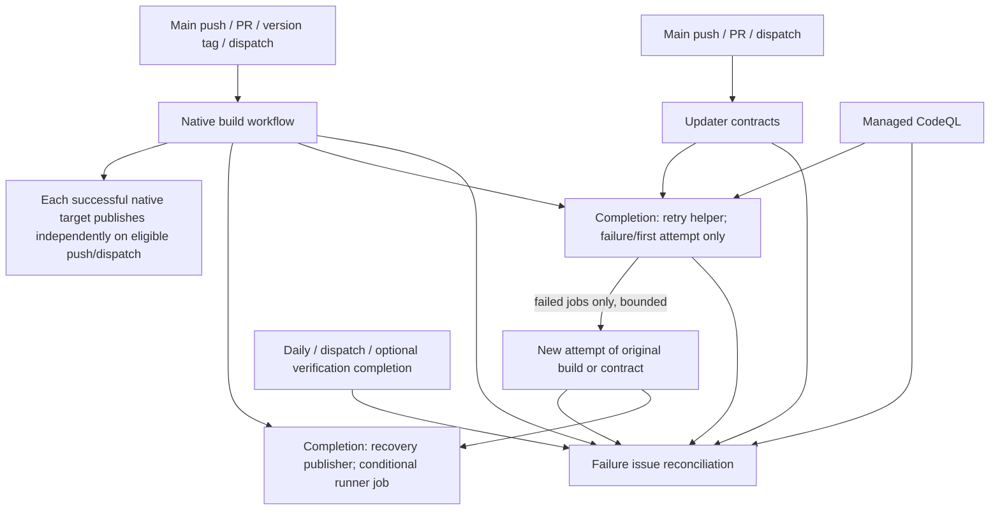

# GitHub Actions audit

Prepared 2026-10-13, America/Los_Angeles. Read-only audit of the current EnCAP repository and every repository accessible to the authenticated GitHub CLI account, `tlolabs`. Reports are local and uncommitted. No workflow, account setting, remote issue, release, branch, or repository protection was modified.

## Executive summary

- **15 repositories examined:** 9 public and 6 private; all are user-owned.
- **66 workflows in the complete Actions registry:** all report `active`; no disabled workflows returned. There are **52 current YAML files**, 12 GitHub-managed workflows, and 2 registered ATIV workflows whose files have been removed from the default branch. Two additional removed EWAF workflow IDs occur only in history; the CSV therefore contains **68 workflow identities**.
- **151 job declarations** in current YAML, including reusable-workflow caller declarations. These are definitions, not simultaneous or executed runner jobs.
- **26 current YAML workflows with automatic triggers**, 3 YAML schedules and 12 reusable (`workflow_call`) files. Twelve GitHub-managed registry entries add managed automation; their complete event configuration is not exposed in YAML. EnCAP CodeQL default setup additionally declares a weekly schedule. Historical-only trigger configurations are distinguished below.
- **1,378 observed workflow runs and 1,399 attempts for those runs** in the last 30 days; **6,760 job records**, including 1,183 skipped jobs. Latest run conclusions: 882 success, 221 failure, 168 cancelled, 107 skipped.
- **22,865.67 observed job-minutes**, or **25,746 minutes** under a simple per-job ceiling model. Neither is a billing total. Linux: 5,387.47; Windows: 8,610.18; macOS: 8,868.02 raw minutes. Parallel jobs and all attempts are included.
- **352.38 raw job-minutes came from private StatStream**; the other five private repositories had no runs in the window. Public standard-runner execution is free, so most proposed reductions save capacity and elapsed feedback time rather than paid runner charges. Private usage can consume the plan allowance or incur overage, including Copilot review; account charges and entitlements are unavailable. [GitHub Actions billing](https://docs.github.com/en/billing/concepts/product-billing/github-actions).
- **131.66 GiB of current nonexpired Actions artifacts** across 2,597 records. This is a point-in-time inventory, not accrued storage billing. Caches are a separate store.

The five largest actionable sources of unnecessary activity are repeated native dependency/compiler setup, Yacht's daily complete native suites, StatStream's repeated advisory-tool installation, Core's overlapping feature-push/PR validation, and ATIV's runner-based publisher polling. Native build totals themselves are not classified as waste. The concrete scenario arithmetic for schedule/tool/push-routing/polling changes is about **1,061–1,099 job-minutes (4.6–4.8%)** of observed runtime, subject to eligibility checks; compiler-cache scenarios may offer more but overlap other changes. Dollar savings cannot be established.

## Scope, evidence and calculation method

The fixed run creation window is **2026-09-13 22:08:12 PDT through 2026-10-13 22:08:12 PDT** (UTC equivalents `2026-09-14T05:08:12.839167+00:00` through `2026-10-14T05:08:12.839167+00:00`). API queries use whole-second bounds. Workflow definitions and storage were read shortly after this cutoff. Default-branch revisions were pinned independently for each repository; EnCAP's eight workspace workflow files match its fetched revision byte-for-byte. Workflow sources evolve, so historical costs do not imply the current triggers generated every recorded run.

Discovery used paginated `GET /user/repos`, not a search-limited repository list. Inventory used every page of `GET /repos/OWNER/REPO/actions/workflows`, with no state filter, plus current workflow-directory contents and historical run IDs. History used paginated `actions/runs` with the creation window, and every page of `actions/runs/RUN/attempts/ATTEMPT/jobs` for all reported attempts. All 1,399 attempt/job requests succeeded. Every repository returned fewer than 1,000 runs in the filtered interval; no query reached the API's filtered-result cap.

Observed runner time is the sum of non-skipped job `completed_at − started_at`, clipped to the fixed cutoff and limited to jobs starting in the window. Queue time is excluded; overlapping jobs count separately. The rounded model sums `ceil(job seconds / 60)` and applies no billing multipliers, entitlement discounts, product exemptions or invoice SKU adjustments. Mean workflow span below is the average of the latest attempt's first non-skipped job start to last job completion, including gaps between jobs; it is elapsed orchestration time, not summed runner time. Job timing comes from API metadata, not live billing telemetry. [GitHub workflow job API](https://docs.github.com/en/rest/actions/workflow-jobs).

Run counts represent run identities created in the window; attempt counts include retries of those identities. An old run created before the window but rerun inside it can be missed by a creation-filter query. Deleted runs are not recoverable from these endpoints. Current source files cannot reconstruct all earlier trigger revisions. Same-head-SHA repeat counts are descriptive: manual platform selections, retry recovery, tag qualification and reporter reconciliation can intentionally reuse a SHA, and PR merge checkouts can differ from push checkouts.

The billing usage endpoint returned **HTTP 404** and indicated the GitHub CLI token needs the `user` scope. No authentication scopes were changed. The connected GitHub app returned no repository entries, so CLI read access was used successfully. Missing `.github/workflows` directories in the six empty repositories and missing policy files were ordinary 404s, not workflow-history failures. [Billing API access requirements](https://docs.github.com/en/rest/billing/usage).

## Repository inventory and source revisions

| Repository | Visibility | Registered workflows | Current YAML | 30d runs | Attempts | Job-minutes | Pinned revision |
| --- | --- | --- | --- | --- | --- | --- | --- |
| tlolabs/encap | public | 12 | 8 | 393 | 405 | 5,360.75 | [3cf5b2b4efc3](https://github.com/tlolabs/encap/commit/3cf5b2b4efc3072a9ac8ab3657395069e1b6fb03) |
| tlolabs/TLo-Labs | public | 0 | 0 | 0 | 0 | 0.00 | [297fd63bb57e](https://github.com/tlolabs/TLo-Labs/commit/297fd63bb57e5138cb06957f2dbf791a5f9a8899) |
| tlolabs/ativ | public | 11 | 7 | 195 | 196 | 2,576.25 | [41b18aa29ccc](https://github.com/tlolabs/ativ/commit/41b18aa29cccccd55187c3d99f6555779876c195) |
| tlolabs/avid-core | public | 15 | 14 | 290 | 290 | 3,293.23 | [7e124a338734](https://github.com/tlolabs/avid-core/commit/7e124a3387349e38cc99e5db7e89a73cc23068ad) |
| tlolabs/chabottv-html | private | 0 | 0 | 0 | 0 | 0.00 | [fdd2fe2808ec](https://github.com/tlolabs/chabottv-html/commit/fdd2fe2808ec0bf71d71d57d2a4b7d517fd21d88) |
| tlolabs/ewaf | public | 10 | 8 | 240 | 247 | 3,134.22 | [5f6badf38d9d](https://github.com/tlolabs/ewaf/commit/5f6badf38d9da9e0d0f54bdb47c60df0a6647ed7) |
| tlolabs/fillr | public | 6 | 6 | 44 | 44 | 3,269.30 | [946bafd206c3](https://github.com/tlolabs/fillr/commit/946bafd206c31927e63ba63b88d2222e8438b296) |
| tlolabs/hyperjump | public | 1 | 1 | 0 | 0 | 0.00 | [ee0b8c19ecdb](https://github.com/tlolabs/hyperjump/commit/ee0b8c19ecdb434fe25c2ce2c59f1262c93c0436) |
| tlolabs/kcrh-html | private | 0 | 0 | 0 | 0 | 0.00 | [6cd0c75b4d0d](https://github.com/tlolabs/kcrh-html/commit/6cd0c75b4d0d15f17c58ad259f65e9b2e0d3a25a) |
| tlolabs/shifts.kcrhradio | private | 0 | 0 | 0 | 0 | 0.00 | [b35714d65e42](https://github.com/tlolabs/shifts.kcrhradio/commit/b35714d65e42e6ef3b3b8d439030aff02a0169da) |
| tlolabs/sounds | private | 1 | 1 | 0 | 0 | 0.00 | [69eda058c37e](https://github.com/tlolabs/sounds/commit/69eda058c37e5046b8e9100878afe95af26bfe6d) |
| tlolabs/spectator-html | private | 0 | 0 | 0 | 0 | 0.00 | [4df9a3173c7b](https://github.com/tlolabs/spectator-html/commit/4df9a3173c7b4e94110ec1c7ced082baabb9e057) |
| tlolabs/statstream | private | 3 | 2 | 28 | 28 | 352.38 | [93dae98306e0](https://github.com/tlolabs/statstream/commit/93dae98306e0e1488960c2012fbd451678b3352a) |
| tlolabs/text2qti | public | 0 | 0 | 0 | 0 | 0.00 | [80dac052bec7](https://github.com/tlolabs/text2qti/commit/80dac052bec7953e5790567cf5a500644886d5b8) |
| tlolabs/yacht | public | 7 | 5 | 188 | 189 | 4,879.53 | [113ce485d2dd](https://github.com/tlolabs/yacht/commit/113ce485d2ddf62aa543afda574f01bf185b31fe) |

The repositories with no workflows and no history are `TLo-Labs`, `chabottv-html`, `kcrh-html`, `shifts.kcrhradio`, `spectator-html` and `text2qti`. `hyperjump` and private `sounds` have configured workflows but zero observed runs. `sounds` could consume private runner allowance when used; zero history does not make its unfiltered push/PR configuration free.

## Complete workflow inventory

`Cur` = current YAML; `Hist` = historical YAML recovered from the newest available run containing the removed file; `Managed` = GitHub-managed without a repository YAML source. Historical-source triggers do not describe current effective behavior. The CSV contains complete branch/tag filters, matrices, dependencies, concurrency and outcome/event counts.

| Repository | Workflow | File | Source | State | Triggers | Observed/configured platforms | Job definitions | Runs | Attempts | Job-minutes |
| --- | --- | --- | --- | --- | --- | --- | --- | --- | --- | --- |
| tlolabs/encap | [Build platform applications](https://github.com/tlolabs/encap/blob/3cf5b2b4efc3072a9ac8ab3657395069e1b6fb03/.github/workflows/build-platforms.yml) | .github/workflows/build-platforms.yml | Cur | active | pull_request, push, workflow_dispatch | Windows, Linux, macOS | 16 | 95 | 107 | 4831.00 |
| tlolabs/encap | [Publish recovered platform artifacts](https://github.com/tlolabs/encap/blob/3cf5b2b4efc3072a9ac8ab3657395069e1b6fb03/.github/workflows/publish-recovered-artifacts.yml) | .github/workflows/publish-recovered-artifacts.yml | Cur | active | workflow_run | Linux | 1 | 31 | 31 | 5.37 |
| tlolabs/encap | [Report CI/CD failures](https://github.com/tlolabs/encap/blob/3cf5b2b4efc3072a9ac8ab3657395069e1b6fb03/.github/workflows/report-ci-failures.yml) | .github/workflows/report-ci-failures.yml | Cur | active | workflow_run, schedule, workflow_dispatch | Linux | 1 | 124 | 124 | 22.10 |
| tlolabs/encap | [Retry failed verification workflows](https://github.com/tlolabs/encap/blob/3cf5b2b4efc3072a9ac8ab3657395069e1b6fb03/.github/workflows/retry-failed-verification.yml) | .github/workflows/retry-failed-verification.yml | Cur | active | workflow_run | Linux | 1 | 61 | 61 | 0.82 |
| tlolabs/encap | [Sign Windows portable packages with Azure](https://github.com/tlolabs/encap/blob/3cf5b2b4efc3072a9ac8ab3657395069e1b6fb03/.github/workflows/sign-windows.yml) | .github/workflows/sign-windows.yml | Cur | active | workflow_dispatch | ${{ matrix.runner }}, windows-11-arm, windows-2025 | 2 | 0 | 0 | 0.00 |
| tlolabs/encap | [Authenticated updater contract](https://github.com/tlolabs/encap/blob/3cf5b2b4efc3072a9ac8ab3657395069e1b6fb03/.github/workflows/updater-contract.yml) | .github/workflows/updater-contract.yml | Cur | active | pull_request, push, workflow_dispatch | Linux, macOS, Windows | 1 | 22 | 22 | 116.18 |
| tlolabs/encap | [Verify and attest native Linux AppImages](https://github.com/tlolabs/encap/blob/3cf5b2b4efc3072a9ac8ab3657395069e1b6fb03/.github/workflows/verify-linux.yml) | .github/workflows/verify-linux.yml | Cur | active | workflow_dispatch | Linux | 2 | 2 | 2 | 1.90 |
| tlolabs/encap | [Verify locally notarized Mac qualification packages](https://github.com/tlolabs/encap/blob/3cf5b2b4efc3072a9ac8ab3657395069e1b6fb03/.github/workflows/verify-macos.yml) | .github/workflows/verify-macos.yml | Cur | active | workflow_dispatch | ${{ matrix.runner }}, macos-15, macos-15-intel | 1 | 0 | 0 | 0.00 |
| tlolabs/encap | [GitHub Advanced Security](https://github.com/tlolabs/encap/actions/workflows/agents/github-advanced-security) | dynamic/agents/github-advanced-security | Managed | active | managed; observed dynamic | Linux |  | 12 | 12 | 22.17 |
| tlolabs/encap | [Dependency Graph](https://github.com/tlolabs/encap/actions/workflows/dependabot/update-graph) | dynamic/dependabot/update-graph | Managed | active | managed; observed  | not observed |  | 0 | 0 | 0.00 |
| tlolabs/encap | [Automatic Dependency Submission](https://github.com/tlolabs/encap/actions/workflows/dependency-graph/auto-submission) | dynamic/dependency-graph/auto-submission | Managed | active | managed; observed dynamic | Linux |  | 3 | 3 | 1.30 |
| tlolabs/encap | [CodeQL](https://github.com/tlolabs/encap/actions/workflows/github-code-scanning/codeql) | dynamic/github-code-scanning/codeql | Managed | active | managed; observed dynamic | Linux |  | 43 | 43 | 359.92 |
| tlolabs/ativ | [Attest and verify native Linux AppImages](https://github.com/tlolabs/ativ/blob/41b18aa29cccccd55187c3d99f6555779876c195/.github/workflows/attest-linux.yml) | .github/workflows/attest-linux.yml | Cur | active | workflow_dispatch | ${{ matrix.runner }}, ubuntu-24.04, ubuntu-24.04-arm | 2 | 0 | 0 | 0.00 |
| tlolabs/ativ | [FFmpeg Windows source diagnostic](https://github.com/tlolabs/ativ/blob/551968543cfae1387a4369931201d07e3626a5ea/.github/workflows/ffmpeg-diagnostic.yml) | .github/workflows/ffmpeg-diagnostic.yml | Hist | active | workflow_dispatch, push | Windows | 1 | 1 | 1 | 20.27 |
| tlolabs/ativ | [Native build, test, and package](https://github.com/tlolabs/ativ/blob/41b18aa29cccccd55187c3d99f6555779876c195/.github/workflows/native-release.yml) | .github/workflows/native-release.yml | Cur | active | workflow_dispatch, pull_request, push | Linux, macOS, Windows | 5 | 99 | 100 | 2289.60 |
| tlolabs/ativ | [Publish independently verified native platforms](https://github.com/tlolabs/ativ/blob/41b18aa29cccccd55187c3d99f6555779876c195/.github/workflows/publish-recovered-artifacts.yml) | .github/workflows/publish-recovered-artifacts.yml | Cur | active | push, workflow_run, workflow_dispatch | Linux | 1 | 6 | 6 | 97.12 |
| tlolabs/ativ | [Recipe 7 host qualification (no publication)](https://github.com/tlolabs/ativ/blob/ba87f58fcd42a7d99d46ab8a5f4d3b96569eb61d/.github/workflows/recipe7-qualification.yml) | .github/workflows/recipe7-qualification.yml | Hist | active | workflow_dispatch, push | Linux, macOS, Windows | 4 | 3 | 3 | 137.18 |
| tlolabs/ativ | [Report CI/CD failures](https://github.com/tlolabs/ativ/blob/41b18aa29cccccd55187c3d99f6555779876c195/.github/workflows/report-ci-failures.yml) | .github/workflows/report-ci-failures.yml | Cur | active | workflow_run, schedule, workflow_dispatch | Linux | 1 | 41 | 41 | 8.05 |
| tlolabs/ativ | [Retry failed verification workflows](https://github.com/tlolabs/ativ/blob/41b18aa29cccccd55187c3d99f6555779876c195/.github/workflows/retry-failed-verification.yml) | .github/workflows/retry-failed-verification.yml | Cur | active | workflow_run | Linux | 1 | 17 | 17 | 0.05 |
| tlolabs/ativ | [Sign Windows portable packages with Azure](https://github.com/tlolabs/ativ/blob/41b18aa29cccccd55187c3d99f6555779876c195/.github/workflows/sign-windows.yml) | .github/workflows/sign-windows.yml | Cur | active | workflow_dispatch | ${{ matrix.runner }}, windows-11-arm, windows-2025 | 2 | 0 | 0 | 0.00 |
| tlolabs/ativ | [Verify locally notarized Mac qualification packages](https://github.com/tlolabs/ativ/blob/41b18aa29cccccd55187c3d99f6555779876c195/.github/workflows/verify-macos.yml) | .github/workflows/verify-macos.yml | Cur | active | workflow_dispatch | ${{ matrix.runner }}, macos-15, macos-15-intel | 1 | 0 | 0 | 0.00 |
| tlolabs/ativ | [Dependabot Updates](https://github.com/tlolabs/ativ/actions/workflows/dependabot/dependabot-updates) | dynamic/dependabot/dependabot-updates | Managed | active | managed; observed dynamic | Linux |  | 27 | 27 | 23.35 |
| tlolabs/ativ | [Dependency Graph](https://github.com/tlolabs/ativ/actions/workflows/dependabot/update-graph) | dynamic/dependabot/update-graph | Managed | active | managed; observed dynamic | Linux |  | 1 | 1 | 0.63 |
| tlolabs/avid-core | [shared-core](https://github.com/tlolabs/avid-core/blob/7e124a3387349e38cc99e5db7e89a73cc23068ad/.github/workflows/ci.yml) | .github/workflows/ci.yml | Cur | active | push, pull_request | Windows, Linux, macOS | 3 | 141 | 141 | 411.98 |
| tlolabs/avid-core | [Windows lrintf compiler regression](https://github.com/tlolabs/avid-core/blob/7e124a3387349e38cc99e5db7e89a73cc23068ad/.github/workflows/compiler-regression.yml) | .github/workflows/compiler-regression.yml | Cur | active | workflow_dispatch | Windows | 1 | 3 | 3 | 5.48 |
| tlolabs/avid-core | [CI/CD failure report](https://github.com/tlolabs/avid-core/blob/7e124a3387349e38cc99e5db7e89a73cc23068ad/.github/workflows/failure-report.yml) | .github/workflows/failure-report.yml | Cur | active | workflow_run | Linux | 1 | 56 | 56 | 17.55 |
| tlolabs/avid-core | [Build one Core FFmpeg platform](https://github.com/tlolabs/avid-core/blob/7e124a3387349e38cc99e5db7e89a73cc23068ad/.github/workflows/ffmpeg-build.yml) | .github/workflows/ffmpeg-build.yml | Cur | active | workflow_call | ${{ inputs.runner }} | 1 | 0 | 0 | 0.00 |
| tlolabs/avid-core | [Recipe 6 failure investigation](https://github.com/tlolabs/avid-core/blob/7e124a3387349e38cc99e5db7e89a73cc23068ad/.github/workflows/ffmpeg-diagnostics.yml) | .github/workflows/ffmpeg-diagnostics.yml | Cur | active | workflow_dispatch | Linux, Windows | 2 | 2 | 2 | 15.27 |
| tlolabs/avid-core | [Windows compiler isolation](https://github.com/tlolabs/avid-core/blob/7e124a3387349e38cc99e5db7e89a73cc23068ad/.github/workflows/ffmpeg-experiments.yml) | .github/workflows/ffmpeg-experiments.yml | Cur | active | workflow_dispatch | Windows | 1 | 1 | 1 | 14.77 |
| tlolabs/avid-core | [FFmpeg platform direct downloads](https://github.com/tlolabs/avid-core/blob/7e124a3387349e38cc99e5db7e89a73cc23068ad/.github/workflows/ffmpeg-independent.yml) | .github/workflows/ffmpeg-independent.yml | Cur | active | push, workflow_dispatch | Windows, macOS, Linux | 12 | 4 | 4 | 431.33 |
| tlolabs/avid-core | [FFmpeg native candidate verification](https://github.com/tlolabs/avid-core/blob/7e124a3387349e38cc99e5db7e89a73cc23068ad/.github/workflows/ffmpeg.yml) | .github/workflows/ffmpeg.yml | Cur | active | workflow_dispatch | Linux, macOS, Windows | 2 | 44 | 44 | 2009.65 |
| tlolabs/avid-core | [Linux lifecycle race regression](https://github.com/tlolabs/avid-core/blob/7e124a3387349e38cc99e5db7e89a73cc23068ad/.github/workflows/lifecycle-repair.yml) | .github/workflows/lifecycle-repair.yml | Cur | active | workflow_dispatch | Linux | 1 | 1 | 1 | 1.72 |
| tlolabs/avid-core | [Publish one verified Core FFmpeg platform](https://github.com/tlolabs/avid-core/blob/7e124a3387349e38cc99e5db7e89a73cc23068ad/.github/workflows/platform-publisher.yml) | .github/workflows/platform-publisher.yml | Cur | active | workflow_call | ubuntu-24.04 | 1 | 0 | 0 | 0.00 |
| tlolabs/avid-core | [Publish existing verified FFmpeg platforms](https://github.com/tlolabs/avid-core/blob/7e124a3387349e38cc99e5db7e89a73cc23068ad/.github/workflows/publish-existing-platforms.yml) | .github/workflows/publish-existing-platforms.yml | Cur | active | workflow_run, workflow_dispatch | Linux | 3 | 12 | 12 | 8.10 |
| tlolabs/avid-core | [Promote verified Core runtime](https://github.com/tlolabs/avid-core/blob/7e124a3387349e38cc99e5db7e89a73cc23068ad/.github/workflows/runtime-release.yml) | .github/workflows/runtime-release.yml | Cur | active | push, workflow_dispatch | Linux | 1 | 1 | 1 | 0.57 |
| tlolabs/avid-core | [source-release](https://github.com/tlolabs/avid-core/blob/7e124a3387349e38cc99e5db7e89a73cc23068ad/.github/workflows/source-release.yml) | .github/workflows/source-release.yml | Cur | active | push | ubuntu-24.04 | 3 | 0 | 0 | 0.00 |
| tlolabs/avid-core | [Windows runtime lifecycle stress](https://github.com/tlolabs/avid-core/blob/7e124a3387349e38cc99e5db7e89a73cc23068ad/.github/workflows/windows-lifecycle.yml) | .github/workflows/windows-lifecycle.yml | Cur | active | workflow_dispatch | Windows | 1 | 10 | 10 | 366.47 |
| tlolabs/avid-core | [Dependabot Updates](https://github.com/tlolabs/avid-core/actions/workflows/dependabot/dependabot-updates) | dynamic/dependabot/dependabot-updates | Managed | active | managed; observed dynamic | Linux |  | 15 | 15 | 10.35 |
| tlolabs/ewaf | [Attest tagged package](https://github.com/tlolabs/ewaf/blob/5f6badf38d9da9e0d0f54bdb47c60df0a6647ed7/.github/workflows/attest-package.yml) | .github/workflows/attest-package.yml | Cur | active | workflow_call | ubuntu-24.04 | 1 | 0 | 0 | 0.00 |
| tlolabs/ewaf | [Build Linux](https://github.com/tlolabs/ewaf/blob/5f6badf38d9da9e0d0f54bdb47c60df0a6647ed7/.github/workflows/build-linux.yml) | .github/workflows/build-linux.yml | Cur | active | workflow_call | ${{ inputs.runner }} | 1 | 0 | 0 | 0.00 |
| tlolabs/ewaf | [Build macOS](https://github.com/tlolabs/ewaf/blob/5f6badf38d9da9e0d0f54bdb47c60df0a6647ed7/.github/workflows/build-macos.yml) | .github/workflows/build-macos.yml | Cur | active | workflow_call | ${{ inputs.runner }} | 1 | 0 | 0 | 0.00 |
| tlolabs/ewaf | [Build Windows](https://github.com/tlolabs/ewaf/blob/5f6badf38d9da9e0d0f54bdb47c60df0a6647ed7/.github/workflows/build-windows.yml) | .github/workflows/build-windows.yml | Cur | active | workflow_call | ${{ inputs.runner }} | 1 | 0 | 0 | 0.00 |
| tlolabs/ewaf | [CI/CD failure report](https://github.com/tlolabs/ewaf/blob/5f6badf38d9da9e0d0f54bdb47c60df0a6647ed7/.github/workflows/failure-report.yml) | .github/workflows/failure-report.yml | Cur | active | workflow_run | Linux | 1 | 29 | 29 | 3.02 |
| tlolabs/ewaf | [Native platforms](https://github.com/tlolabs/ewaf/blob/5f6badf38d9da9e0d0f54bdb47c60df0a6647ed7/.github/workflows/native.yml) | .github/workflows/native.yml | Cur | active | push, pull_request, workflow_dispatch | Linux, Windows, macOS | 20 | 86 | 93 | 2680.67 |
| tlolabs/ewaf | [Bounded native CI retry](https://github.com/tlolabs/ewaf/blob/5f6badf38d9da9e0d0f54bdb47c60df0a6647ed7/.github/workflows/retry-failed-native.yml) | .github/workflows/retry-failed-native.yml | Cur | active | workflow_run | Linux | 1 | 28 | 28 | 0.42 |
| tlolabs/ewaf | [Native platforms](https://github.com/tlolabs/ewaf/blob/1f4bf881db4dc2880bb76080507d035d8c504f72/.github/workflows/swift.yml) | .github/workflows/swift.yml | Hist | history-only; current status unknown | push, pull_request, workflow_dispatch | Linux, macOS, Windows | 5 | 25 | 25 | 402.03 |
| tlolabs/ewaf | [Tests](https://github.com/tlolabs/ewaf/blob/16004aa531107d5bcfe926089db3b9bdaa7fa1b5/.github/workflows/test.yml) | .github/workflows/test.yml | Hist | history-only; current status unknown | push, pull_request | Linux | 1 | 22 | 22 | 8.08 |
| tlolabs/ewaf | [Published update authentication](https://github.com/tlolabs/ewaf/blob/5f6badf38d9da9e0d0f54bdb47c60df0a6647ed7/.github/workflows/update-qualification.yml) | .github/workflows/update-qualification.yml | Cur | active | release, workflow_dispatch | ubuntu-24.04 | 1 | 1 | 1 | 0.00 |
| tlolabs/ewaf | [Dependabot Updates](https://github.com/tlolabs/ewaf/actions/workflows/dependabot/dependabot-updates) | dynamic/dependabot/dependabot-updates | Managed | active | managed; observed dynamic | Linux |  | 46 | 46 | 37.50 |
| tlolabs/ewaf | [Dependency Graph](https://github.com/tlolabs/ewaf/actions/workflows/dependabot/update-graph) | dynamic/dependabot/update-graph | Managed | active | managed; observed dynamic | Linux |  | 3 | 3 | 2.50 |
| tlolabs/fillr | [Build FILLR Linux package](https://github.com/tlolabs/fillr/blob/946bafd206c31927e63ba63b88d2222e8438b296/.github/workflows/build-linux.yml) | .github/workflows/build-linux.yml | Cur | active | workflow_call | ${{ inputs.runner }} | 1 | 0 | 0 | 0.00 |
| tlolabs/fillr | [Build FILLR Windows package](https://github.com/tlolabs/fillr/blob/946bafd206c31927e63ba63b88d2222e8438b296/.github/workflows/build-windows.yml) | .github/workflows/build-windows.yml | Cur | active | workflow_call | ${{ inputs.runner }} | 1 | 0 | 0 | 0.00 |
| tlolabs/fillr | [Build FILLR desktop packages](https://github.com/tlolabs/fillr/blob/946bafd206c31927e63ba63b88d2222e8438b296/.github/workflows/build.yml) | .github/workflows/build.yml | Cur | active | workflow_dispatch, push | Linux, Windows, macOS | 14 | 44 | 44 | 3269.30 |
| tlolabs/fillr | [Publish verified direct download](https://github.com/tlolabs/fillr/blob/946bafd206c31927e63ba63b88d2222e8438b296/.github/workflows/publish-direct.yml) | .github/workflows/publish-direct.yml | Cur | active | workflow_call | ubuntu-24.04 | 1 | 0 | 0 | 0.00 |
| tlolabs/fillr | [Publish qualified stable updates](https://github.com/tlolabs/fillr/blob/946bafd206c31927e63ba63b88d2222e8438b296/.github/workflows/publish-updates.yml) | .github/workflows/publish-updates.yml | Cur | active | workflow_dispatch | ubuntu-24.04 | 1 | 0 | 0 | 0.00 |
| tlolabs/fillr | [Optional signed stable update candidates](https://github.com/tlolabs/fillr/blob/946bafd206c31927e63ba63b88d2222e8438b296/.github/workflows/release-updates.yml) | .github/workflows/release-updates.yml | Cur | active | workflow_dispatch | ${{ matrix.runner }}, macos-15, ubuntu-24.04, ubuntu-24.04-arm, windows-11-arm, windows-2025 | 5 | 0 | 0 | 0.00 |
| tlolabs/hyperjump | [Build macOS DMG](https://github.com/tlolabs/hyperjump/blob/ee0b8c19ecdb434fe25c2ce2c59f1262c93c0436/.github/workflows/release-macos.yml) | .github/workflows/release-macos.yml | Cur | active | workflow_dispatch, push | macos-latest | 1 | 0 | 0 | 0.00 |
| tlolabs/sounds | [Build and test](https://github.com/tlolabs/sounds/blob/69eda058c37e5046b8e9100878afe95af26bfe6d/.github/workflows/build.yml) | .github/workflows/build.yml | Cur | active | push, pull_request | macos-15, ubuntu-latest, windows-latest | 4 | 0 | 0 | 0.00 |
| tlolabs/statstream | [macOS ARM64 build, report and independent publication](https://github.com/tlolabs/statstream/blob/93dae98306e0e1488960c2012fbd451678b3352a/.github/workflows/macos-release.yml) | .github/workflows/macos-release.yml | Cur | active | push, workflow_dispatch | macOS | 1 | 12 | 12 | 277.35 |
| tlolabs/statstream | [Nonblocking source and dependency reports](https://github.com/tlolabs/statstream/blob/93dae98306e0e1488960c2012fbd451678b3352a/.github/workflows/reporting.yml) | .github/workflows/reporting.yml | Cur | active | pull_request, workflow_dispatch | macOS | 1 | 8 | 8 | 21.12 |
| tlolabs/statstream | [Copilot](https://github.com/tlolabs/statstream/actions/workflows/agents/copilot-pull-request-reviewer) | dynamic/agents/copilot-pull-request-reviewer | Managed | active | managed; observed dynamic | Linux |  | 8 | 8 | 53.92 |
| tlolabs/yacht | [Build linux application](https://github.com/tlolabs/yacht/blob/113ce485d2ddf62aa543afda574f01bf185b31fe/.github/workflows/build-linux.yml) | .github/workflows/build-linux.yml | Cur | active | workflow_call | ${{ inputs.arch == 'arm64' && 'ubuntu-24.04-arm' \|\| 'ubuntu-24.04' }} | 1 | 0 | 0 | 0.00 |
| tlolabs/yacht | [Build macos application](https://github.com/tlolabs/yacht/blob/113ce485d2ddf62aa543afda574f01bf185b31fe/.github/workflows/build-macos.yml) | .github/workflows/build-macos.yml | Cur | active | workflow_call | ${{ inputs.arch == 'arm64' && 'macos-26' \|\| 'macos-15-intel' }} | 1 | 0 | 0 | 0.00 |
| tlolabs/yacht | [Build windows application](https://github.com/tlolabs/yacht/blob/113ce485d2ddf62aa543afda574f01bf185b31fe/.github/workflows/build-windows.yml) | .github/workflows/build-windows.yml | Cur | active | workflow_call | ${{ inputs.arch == 'arm64' && 'windows-11-arm' \|\| 'windows-2025' }} | 1 | 0 | 0 | 0.00 |
| tlolabs/yacht | [Native cross-platform](https://github.com/tlolabs/yacht/blob/113ce485d2ddf62aa543afda574f01bf185b31fe/.github/workflows/native-macos.yml) | .github/workflows/native-macos.yml | Cur | active | push, pull_request, workflow_dispatch, schedule | Windows, macOS, Linux | 18 | 155 | 156 | 4852.87 |
| tlolabs/yacht | [Published update authentication](https://github.com/tlolabs/yacht/blob/113ce485d2ddf62aa543afda574f01bf185b31fe/.github/workflows/update-qualification.yml) | .github/workflows/update-qualification.yml | Cur | active | release, workflow_dispatch | ubuntu-24.04 | 2 | 1 | 1 | 0.00 |
| tlolabs/yacht | [Dependabot Updates](https://github.com/tlolabs/yacht/actions/workflows/dependabot/dependabot-updates) | dynamic/dependabot/dependabot-updates | Managed | active | managed; observed dynamic | Linux |  | 31 | 31 | 25.97 |
| tlolabs/yacht | [Dependency Graph](https://github.com/tlolabs/yacht/actions/workflows/dependabot/update-graph) | dynamic/dependabot/update-graph | Managed | active | managed; observed dynamic | Linux |  | 1 | 1 | 0.70 |

## Usage concentration

| Repository/workflow | Runs | Job-minutes | Share | Mean latest-attempt span (min) | Success / failure / cancelled / skipped |
| --- | --- | --- | --- | --- | --- |
| tlolabs/yacht / Native cross-platform | 155 | 4,852.87 | 21.2% | 15.34 | 66 / 24 / 65 / 0 |
| tlolabs/encap / Build platform applications | 95 | 4,831.00 | 21.1% | 19.09 | 37 / 51 / 7 / 0 |
| tlolabs/fillr / Build FILLR desktop packages | 44 | 3,269.30 | 14.3% | 22.27 | 24 / 11 / 9 / 0 |
| tlolabs/ewaf / Native platforms | 86 | 2,680.67 | 11.7% | 21.17 | 35 / 30 / 21 / 0 |
| tlolabs/ativ / Native build, test, and package | 99 | 2,289.60 | 10.0% | 8.90 | 42 / 30 / 27 / 0 |
| tlolabs/avid-core / FFmpeg native candidate verification | 44 | 2,009.65 | 8.8% | 13.50 | 4 / 12 / 28 / 0 |
| tlolabs/avid-core / FFmpeg platform direct downloads | 4 | 431.33 | 1.9% | 32.82 | 3 / 1 / 0 / 0 |
| tlolabs/avid-core / shared-core | 141 | 411.98 | 1.8% | 3.06 | 111 / 30 / 0 / 0 |
| tlolabs/ewaf / Native platforms | 25 | 402.03 | 1.8% | 7.85 | 11 / 6 / 8 / 0 |
| tlolabs/avid-core / Windows runtime lifecycle stress | 10 | 366.47 | 1.6% | 16.85 | 5 / 5 / 0 / 0 |
| tlolabs/encap / CodeQL | 43 | 359.92 | 1.6% | 4.54 | 42 / 1 / 0 / 0 |
| tlolabs/statstream / macOS ARM64 build, report and independent publication | 12 | 277.35 | 1.2% | 7.90 | 12 / 0 / 0 / 0 |

| Trigger | Observed run identities |
| --- | --- |
| dynamic | 190 |
| pull_request | 282 |
| push | 325 |
| release | 2 |
| schedule | 31 |
| workflow_dispatch | 165 |
| workflow_run | 383 |

EnCAP has 95 native build runs consuming 4,831.00 minutes: 24 push runs (2,326.37 minutes), 16 PR runs (437.02), and 55 manual dispatches (2,067.62). The current build already restricts pushes to main and version tags, so it does **not** duplicate every feature-branch push and PR. Its one same-SHA push/PR pair includes a version tag and is retained as release qualification. Manual dispatches may select different platforms and are not automatically redundant.

EnCAP's 12 extra attempts consumed 768.58 minutes; EWAF's seven consumed 242.73, Yacht's one 52.05 and ATIV's one 40.40. Total additional-attempt work is 1,103.77 minutes. Successful retries and transient failures require diagnosis; these minutes are not all removable. Cancelled job work totaled 3,147.98 minutes and is likewise not an achievable-savings figure.

## Trigger map and execution chains

### EnCAP

- **Main push:** starts `Build platform applications` (quality, six native targets, applicable internal Qt/Btrfs diagnostics and six independent publisher jobs) and the three-platform `Authenticated updater contract`. The runtime-probes job requires an explicit `platform: runtime-probes` dispatch. CodeQL/dependency/agent automation can add managed runs; the complete managed event mapping is unavailable.
- **PR opened, reopened or synchronized:** starts native build validation and updater contracts. Publication predicates exclude PRs. No YAML filters PR target branches or changed paths.
- **v* tag push:** starts native build qualification and stable publication; updater-contract has a main-branch push filter and no tag route. Branch filters do not make tags require a matching branch. Publication additionally validates the exact version/tag identity in the script.
- **Dispatch:** native build can select `all`, `macos`, `windows`, `linux`, `checks` or `runtime-probes`; quality always runs. Mac/Linux follow-on diagnostics depend on their specific package jobs. Windows signing, Linux attestation and final notarized Mac verification are separate dispatch-only artifact consumers, with no native rebuild of the input package.
- **Every completed build:** creates recovery-publisher and retry-helper workflow records, and updates the failure report. Recovery runs its job only for first-party eligible push runs that failed or were rerun. It republishes missing verified platforms; it does not rebuild them. The retry job only acts on a first-party failure with attempt <2, and invokes `gh run rerun --failed`.
- **Every completed updater-contract or CodeQL run:** triggers the retry helper and failure reporter; helpers may skip their runner jobs on success. Reporter also watches optional verification/signing and retry-helper completion. The retried source run completes again and causes another reconciliation/recovery cycle; attempt limits bound this behavior.
- **Daily 06:17 UTC:** reconciles the failure issue. CodeQL default setup is configured for weekly scans with languages actions, C/C++, Python and Rust, default queries, remote threat model and a standard runner. API history labels CodeQL runs `dynamic`; the exact cause of each scan is not exposed as YAML or inferred from the nearby build.



The recovery publisher itself is not in EnCAP's reporter watched-workflow list; retries and build failures are still visible, but recovery-specific failures merit inclusion when refactoring. Completion helpers use the default-branch workflow definition and may record its SHA rather than the upstream commit; report same-SHA counts cannot deduplicate those events.

### Other repositories

- **ATIV:** main/v* pushes and PRs start its native workflow; dispatcher inputs select platform groups. Native completion triggers a bounded retry helper and failure reporter. A separate publisher starts on main/v* pushes and polls for per-platform completion. Its intended requested/completed trigger is currently misparsed because the comma-containing workflow name is unquoted; the parsed names and actual workflow name do not match. All six observed publisher runs were push/dispatch. A reporter also watches publisher completion, optional signed-package verification, CodeQL by name and retry completion. Daily report reconciliation remains configured. Its two removed diagnostic workflows still show active registry entries; historical sources explain their four prior push runs.
- **AVID Core:** unfiltered push and PR events start `shared-core`. Relevant main source/runtime changes start six reusable FFmpeg builds and six independent reusable publishers. Candidate verification is currently dispatch-only with a dynamically generated target matrix. Completed candidates may start a recovery workflow whose automatic backfill predicate is tied to one historical run ID; its push-only job is unreachable from the current trigger set. Tag `ffmpeg-*-r*.*` starts runtime promotion; v* tags start source packaging, attestation and publication. Diagnostic stress/investigation workflows are now manual. The consolidated reporter watches the configured completion names. Historical automatic diagnostic runs are not evidence that those current dispatch-only files still execute on pushes.
- **EWAF:** main/v* pushes and PRs start quality and six reusable native builds, Mac icon/reference checks, four attestations and six platform release jobs. Successful eligible main builds publish exact-commit development prereleases as required by policy; stable/beta/RC behavior depends on tag/version validation. Native completion creates failure-report and bounded-retry workflows. Final stable release publication can start update authentication, conditional on the signed update manifest. Removed `swift.yml` and `test.yml` consumed 447.63 minutes in 47 historical runs and are not current savings targets.
- **FILLR:** main, `codex/**` and v* pushes start security/updater diagnostics, a universal Mac build, x64/ARM64 Windows and Linux reusable builds, and the internal Mac reference. Tag-only publisher callers release each verified artifact independently. Failure reporting is a dependent nonblocking diagnostic job. Optional signed update candidate building and qualified update publication are manual and use final artifacts/upgrade evidence. They are distinct capabilities and not automatically duplicated by every development push.
- **Yacht:** main/v* (except v1.*) pushes start the native suite, with Markdown/docs path exclusions on pushes; PRs are unfiltered. Manual and daily scheduled runs also build all native targets and internal reference coverage. Source/run-bound release initialization and independent platform publishers run only on eligible main/tag push or dispatch. Published stable release authentication runs downstream without rebuilding native applications. Its workflow-level non-tag cancellation deserves review for publisher interruption.
- **StatStream (private):** main/v[0-9]* pushes and manual dispatch build/package five distinct Mac ARM64 applications. Each matrix job repeats common Rust build/tests and cargo-audit installation; each package and native launch remains application-specific. PRs run a separate native Rust report job, and managed Copilot review adds dynamic Ubuntu runs. There are no schedules. Same-SHA branch/tag builds need release identity preserved; they are not blanket duplicates.
- **Sounds (private):** all pushes and PRs can start Linux quality/Android, native Apple and Windows jobs. No runs were observed. Add event/path routing only after its production targets and platform-specific contracts are mapped; there is no measured savings claim.
- **Hyperjump:** v* tags or manual dispatch build a native macOS DMG; zero observed runs. Its low-frequency native production packaging cannot safely be replaced with Linux.

No current YAML uses `pull_request_target`, `create`, `delete`, `repository_dispatch` or `release` actions other than published. Tag creation triggers the configured **push tag filters**, not a separate `create` route. Reusable `workflow_call` definitions run inside callers, not as additional independent workflow identities; their actual runner jobs are counted once from the caller run history. GitHub-token-created tags/releases normally do not recursively trigger standard workflows (dispatch events are exceptions), so a configured release/push route is not proof that every publisher-generated event cascades. [GitHub event triggering rules](https://docs.github.com/en/actions/how-tos/write-workflows/choose-when-workflows-run/trigger-a-workflow), [workflow_run behavior](https://docs.github.com/en/actions/reference/workflows-and-actions/events-that-trigger-workflows).

## Optimization recommendations

| ID | Priority | Target | Measured baseline / modeled opportunity |
| --- | --- | --- | --- |
| H1 | High | tlolabs/statstream — macos-release.yml | Illustrative 80% installation-time reduction: 94.47 × 0.80 = 75.58 macOS job-minutes over the observed window; zero workflow runs removed. Common scan savings are additional and not quantified. |
| H2 | High | tlolabs/encap — build-platforms.yml; tlolabs/ativ — native-release.yml; tlolabs/ewaf — native.yml and build-*.yml; tlolabs/yacht — native-macos.yml and build-*.yml | Scenario only: reducing EnCAP build runtime by 10–20% would save 483.10–966.20 job-minutes. Applying 10% to all five workflows models 1,792.34 minutes before overlaps; neither cache hit rates nor achieved savings were measured. |
| H3 | High | tlolabs/yacht — native-macos.yml | Retrospective scenario: preserve 6.83 minutes of identifiable scheduled compliance/security/report work, run native work on 4 rather than 27 dates, and save (925.80 − 6.83) × 23/27 = 782.82 job-minutes; 23 full native suites avoided, with daily lightweight diagnostics still running. A replay of evolving historical YAML is not a future forecast. |
| M1 | Medium | tlolabs/avid-core — ci.yml (shared-core) | Upper-bound candidate pool: 55 runs / 155.35 minutes in the observed window. Actual savings require confirming the PR existed at push time and preserves the intended validation. Do not count tag-versus-PR or main-versus-PR runs as redundant. |
| M2 | Medium | tlolabs/ativ — publish-recovered-artifacts.yml and native-release.yml | Scenario only: avoiding 50–90% of the observed polling-job runtime would save 47.63–85.73 Linux minutes. Correcting the trigger alone can add completion executions and is not a savings claim. |
| M3 | Medium | tlolabs/encap — build-platforms.yml and updater-contract.yml; tlolabs/ativ, tlolabs/ewaf and tlolabs/fillr native entry points | No measured savings claim. If 10% of the recorded EnCAP push workload were proven unrelated, the modeled reduction is 10% × (2,326.37 + 99.63) = 242.60 minutes. Full multi-commit push and PR diffs must be replayed before assigning an eligible run count. |
| M4 | Medium | tlolabs/encap — build-platforms.yml; selected diagnostic workflows across repositories | Not quantified: requires overlap intervals and knowing which cancelled job work a newer PR superseded. Existing cancellation savings cannot be counted again. |
| M5 | Medium | tlolabs/encap — build-platforms.yml and script/build_and_run.sh | Not quantified. Wrapper-step times combine compilation, packaging and tests, so deleting the entire wrapper duration would be invalid. Measure the second Swift compilation/test invocation first. |
| L1 | Low | tlolabs/encap / tlolabs/ativ failure reporters and retry helpers; tlolabs/avid-core failure-report.yml | EnCAP reporter 50% runtime reduction would model only 11.05 minutes. There were 21 extra run attempts across all repositories, using 1,103.77 minutes; this is a retry baseline, not proven unnecessary work or promised savings. |
| L2 | Low | Artifact upload steps across tlolabs/encap, tlolabs/ativ, tlolabs/yacht, tlolabs/ewaf, tlolabs/fillr, tlolabs/avid-core and tlolabs/statstream | No runner-minute savings claim. Steady-state storage is approximately upload GiB/day × retention days; lowering eligible retention from 90 to 14 days would model 84.4% reduction for that subset only. Repository defaults and eligible bytes were not verified, so that is not an account-wide storage or dollar forecast. |

The companion [github-actions-optimization.md](/Users/tlothian/Documents/Projects/EnCAP/github-actions-optimization.md) contains behavior, inefficiency, proposed changes, calculations, consequences, difficulty, source links and example YAML for each item. None was applied.

## Artifact/cache storage

| Repository | Nonexpired artifact count | Current artifacts (GiB) | Active cache count | Active caches (GiB) |
| --- | --- | --- | --- | --- |
| tlolabs/encap | 575 | 43.20 | 61 | 3.28 |
| tlolabs/ativ | 343 | 41.01 | 0 | 0.00 |
| tlolabs/avid-core | 269 | 5.06 | 16 | 2.17 |
| tlolabs/ewaf | 495 | 10.92 | 0 | 0.00 |
| tlolabs/fillr | 185 | 9.82 | 14 | 2.41 |
| tlolabs/statstream | 60 | 0.74 | 7 | 2.43 |
| tlolabs/yacht | 670 | 20.90 | 0 | 0.00 |

These sizes exclude release assets and do not reconstruct historical GiB-hours. EnCAP has existing cache records, but none of its current workflow files includes an explicit cache restore step. ATIV, EWAF and Yacht currently have no active cache entries. StatStream does cache Qt and Rust; its separately installed cargo-audit binary is outside those cached paths. Retention recommendations must preserve consumers of qualification artifacts and matching runtime source archives. No artifact or cache was deleted.

## Verification and limitations

- Complete registry pagination included disabled states; zero disabled workflows were returned. Active registry entries with deleted files are explicitly identified, not treated as executable current YAML.
- All 52 current YAML files, all 12 reusable definitions, job-level dependencies, concurrency and inline actions were inspected. Core candidate verification generates its matrix from `runtime/ffmpeg/spec.json`; the YAML expression and observed platforms are recorded, but a supplemental specification read returned HTTP 403 (API rate limit). Its exact current generated matrix therefore remains unresolved rather than assumed from historical jobs. EnCAP's composite runtime-acquisition action authenticates pinned Core outputs and preserves matching source/runtime archives; this is acquisition/reuse, not rebuilding FFmpeg.
- EnCAP's older source-FFmpeg build steps are no longer in its current workflow; current native jobs acquire authenticated pinned Core artifacts. Historical source-build minutes are not a new optimization opportunity.
- Historical source was recovered for both missing ATIV files and two EWAF history-only workflow IDs. A historical snapshot is the newest run containing the path, not a full reconstruction of every prior revision. Dynamic workflow definitions, managed agent event settings and per-execution billing SKUs remain unavailable; CodeQL default-setup configuration was read separately.
- All requested run/attempt/job pages succeeded, all returned jobs were completed when sampled, and every workflow row appears in the CSV. 107 latest run conclusions and 1,183 job records are skipped; those are separated from nonzero runner execution.
- Current public workflow runner labels are standard macOS/Windows/Ubuntu labels; no self-hosted or custom larger-runner labels were observed in executed job metadata. CodeQL confirms a standard runner. The invoice is still needed to establish charges, included allowance consumption and exemptions for managed automation/storage.
- No historical event payload/complete changed-file replay was collected, so path-filter eligibility and PR-open-at-push-time eligibility remain unverified. No speculative dollar estimate or cancellation savings is asserted.
- Native architectures, OS-specific UI/ABI/package checks, optional signing final-byte checks, Core source/runtime verification, security automation and final published-update authentication cannot safely be deleted just to reduce minutes. Reusable build/publisher workflows already avoid most release-triggered recompilation. StatStream's per-artifact launch-eligibility gap and ATIV's malformed trigger are recorded as review risks, with no remote mutations.
- The recommendations preserve repository nonblocking policies, per-artifact functional publication requirements, independent target release capability, voluntary DCO and optional distribution signing. They do not introduce branch protection, mandatory reviews, blocking diagnostics, cryptographic prerequisites for direct downloads or paid services.

## Detailed workflow configuration

This appendix records every recoverable workflow source's full event/branch/tag/path configuration, runners, matrices, caller parameters and dependencies. GitHub-managed rows record observed execution evidence with unknown configuration kept explicit.

### tlolabs/encap — Build platform applications (ID 264977466)

File: `.github/workflows/build-platforms.yml`. State: `active`. Source: current. Purpose: Build/test/package/verification.

Trigger configuration (JSON representation of parsed YAML):

```json
{
  "pull_request": null,
  "push": {
    "branches": [
      "main"
    ],
    "tags": [
      "v*"
    ]
  },
  "workflow_dispatch": {
    "inputs": {
      "platform": {
        "description": "Platform group to qualify",
        "type": "choice",
        "options": [
          "all",
          "macos",
          "windows",
          "linux",
          "checks",
          "runtime-probes"
        ],
        "default": "all"
      }
    }
  }
}
```

Workflow concurrency: `null`. `null` means none declared.

| Job | Runner or reusable call | Strategy/matrix | Needs | Execution condition | Reusable inputs | Job concurrency |
| --- | --- | --- | --- | --- | --- | --- |
| quality | ubuntu-latest | {} | null | default success predicate | — | null |
| macos_arm64 | macos-15 | {} | null | ${{ inputs.platform == '' \|\| inputs.platform == 'all' \|\| inputs.platform == 'macos' }} | — | null |
| macos_intel | macos-15-intel | {} | null | ${{ inputs.platform == '' \|\| inputs.platform == 'all' \|\| inputs.platform == 'macos' }} | — | null |
| windows_x64 | windows-2025 | {} | null | inputs.platform == '' \|\| inputs.platform == 'all' \|\| inputs.platform == 'windows' | — | null |
| windows_arm64 | windows-11-arm | {} | null | inputs.platform == '' \|\| inputs.platform == 'all' \|\| inputs.platform == 'windows' | — | null |
| linux_x64 | ubuntu-24.04 | {} | null | inputs.platform == '' \|\| inputs.platform == 'all' \|\| inputs.platform == 'linux' | — | null |
| linux_arm64 | ubuntu-24.04-arm | {} | null | inputs.platform == '' \|\| inputs.platform == 'all' \|\| inputs.platform == 'linux' | — | null |
| windows_runtime_probes | windows-2025 | {} | null | inputs.platform == 'runtime-probes' | — | null |
| macos_reference | macos-15 | {} | ["macos_arm64"] | default success predicate | — | null |
| linux_btrfs | ubuntu-24.04 | {} | ["linux_x64"] | default success predicate | — | null |
| publish_macos_arm64 | ubuntu-24.04 | {} | ["macos_arm64"] | (github.event_name == 'push' \|\| github.event_name == 'workflow_dispatch') && (github.ref == 'refs/heads/main' \|\| startsWith(github.ref, 'refs/tags/v')) && needs.macos_arm64.result == 'success' | — | null |
| publish_macos_intel | ubuntu-24.04 | {} | ["macos_intel"] | (github.event_name == 'push' \|\| github.event_name == 'workflow_dispatch') && (github.ref == 'refs/heads/main' \|\| startsWith(github.ref, 'refs/tags/v')) && needs.macos_intel.result == 'success' | — | null |
| publish_windows_x64 | ubuntu-24.04 | {} | ["windows_x64"] | (github.event_name == 'push' \|\| github.event_name == 'workflow_dispatch') && (github.ref == 'refs/heads/main' \|\| startsWith(github.ref, 'refs/tags/v')) && needs.windows_x64.result == 'success' | — | null |
| publish_windows_arm64 | ubuntu-24.04 | {} | ["windows_arm64"] | (github.event_name == 'push' \|\| github.event_name == 'workflow_dispatch') && (github.ref == 'refs/heads/main' \|\| startsWith(github.ref, 'refs/tags/v')) && needs.windows_arm64.result == 'success' | — | null |
| publish_linux_x64 | ubuntu-24.04 | {} | ["linux_x64"] | (github.event_name == 'push' \|\| github.event_name == 'workflow_dispatch') && (github.ref == 'refs/heads/main' \|\| startsWith(github.ref, 'refs/tags/v')) && needs.linux_x64.result == 'success' | — | null |
| publish_linux_arm64 | ubuntu-24.04 | {} | ["linux_arm64"] | (github.event_name == 'push' \|\| github.event_name == 'workflow_dispatch') && (github.ref == 'refs/heads/main' \|\| startsWith(github.ref, 'refs/tags/v')) && needs.linux_arm64.result == 'success' | — | null |

Cache actions: `[]`. Artifact uploads: `[{"job":"macos_arm64","name":"EnCap-macos-arm64","retention_days":"repository default"},{"job":"macos_intel","name":"EnCap-macos-intel","retention_days":"repository default"},{"job":"windows_x64","name":"EnCap-windows-x64","retention_days":"repository default"},{"job":"windows_arm64","name":"EnCap-windows-arm64","retention_days":"repository default"},{"job":"linux_x64","name":"EnCap-linux-x64","retention_days":"repository default"},{"job":"linux_arm64","name":"EnCap-linux-arm64","retention_days":"repository default"},{"job":"macos_reference","name":"EnCap-INTERNAL-Qt-Reference-osx-arm64","retention_days":"repository default"}]`.

Observed: 95 runs / 107 attempts / 995 job records; 4831.00 summed job-minutes. Events: `{"push":24,"workflow_dispatch":55,"pull_request":16}`. Latest conclusions: `{"success":37,"failure":51,"cancelled":7}`. Repeated-head-SHA excess records: 19 (not an automatic duplication finding).

### tlolabs/encap — Publish recovered platform artifacts (ID 381619204)

File: `.github/workflows/publish-recovered-artifacts.yml`. State: `active`. Source: current. Purpose: Publication/recovery.

Trigger configuration (JSON representation of parsed YAML):

```json
{
  "workflow_run": {
    "workflows": [
      "Build platform applications"
    ],
    "types": [
      "completed"
    ]
  }
}
```

Workflow concurrency: `null`. `null` means none declared.

| Job | Runner or reusable call | Strategy/matrix | Needs | Execution condition | Reusable inputs | Job concurrency |
| --- | --- | --- | --- | --- | --- | --- |
| publish | ubuntu-24.04 | {} | null | github.event.workflow_run.event == 'push' && github.event.workflow_run.head_repository.full_name == github.repository && (github.event.workflow_run.run_attempt > 1 \|\| github.event.workflow_run.conclusion == 'failure') && (github.event.workflow_run.head_branch == 'main' \|\| startsWith(github.event.workflow_run.head_branch, 'v')) | — | null |

Cache actions: `[]`. Artifact uploads: `[]`.

Observed: 31 runs / 31 attempts / 31 job records; 5.37 summed job-minutes. Events: `{"workflow_run":31}`. Latest conclusions: `{"skipped":19,"success":10,"failure":2}`. Repeated-head-SHA excess records: 23 (not an automatic duplication finding).

### tlolabs/encap — Report CI/CD failures (ID 381619208)

File: `.github/workflows/report-ci-failures.yml`. State: `active`. Source: current. Purpose: Diagnostic maintenance.

Trigger configuration (JSON representation of parsed YAML):

```json
{
  "workflow_run": {
    "workflows": [
      "Build platform applications",
      "Authenticated updater contract",
      "Sign Windows portable packages with Azure",
      "Verify and attest native Linux AppImages",
      "Verify locally notarized Mac qualification packages",
      "CodeQL",
      "Retry failed verification workflows"
    ],
    "types": [
      "completed"
    ]
  },
  "schedule": [
    {
      "cron": "17 6 * * *"
    }
  ],
  "workflow_dispatch": null
}
```

Workflow concurrency: `null`. `null` means none declared.

| Job | Runner or reusable call | Strategy/matrix | Needs | Execution condition | Reusable inputs | Job concurrency |
| --- | --- | --- | --- | --- | --- | --- |
| update-report | ubuntu-24.04 | {} | null | default success predicate | — | null |

Cache actions: `[]`. Artifact uploads: `[]`.

Observed: 124 runs / 124 attempts / 124 job records; 22.10 summed job-minutes. Events: `{"schedule":2,"workflow_run":122}`. Latest conclusions: `{"success":124}`. Repeated-head-SHA excess records: 110 (not an automatic duplication finding).

### tlolabs/encap — Retry failed verification workflows (ID 381619210)

File: `.github/workflows/retry-failed-verification.yml`. State: `active`. Source: current. Purpose: Bounded retry maintenance.

Trigger configuration (JSON representation of parsed YAML):

```json
{
  "workflow_run": {
    "workflows": [
      "Build platform applications",
      "Authenticated updater contract",
      "CodeQL"
    ],
    "types": [
      "completed"
    ]
  }
}
```

Workflow concurrency: `null`. `null` means none declared.

| Job | Runner or reusable call | Strategy/matrix | Needs | Execution condition | Reusable inputs | Job concurrency |
| --- | --- | --- | --- | --- | --- | --- |
| retry-once | ubuntu-24.04 | {} | null | github.event.workflow_run.conclusion == 'failure' && github.event.workflow_run.run_attempt < 2 && github.event.workflow_run.head_repository.full_name == github.repository | — | null |

Cache actions: `[]`. Artifact uploads: `[]`.

Observed: 61 runs / 61 attempts / 61 job records; 0.82 summed job-minutes. Events: `{"workflow_run":61}`. Latest conclusions: `{"skipped":49,"failure":2,"success":10}`. Repeated-head-SHA excess records: 47 (not an automatic duplication finding).

### tlolabs/encap — Sign Windows portable packages with Azure (ID 374797738)

File: `.github/workflows/sign-windows.yml`. State: `active`. Source: current. Purpose: Optional signed artifact qualification.

Trigger configuration (JSON representation of parsed YAML):

```json
{
  "workflow_dispatch": {
    "inputs": {
      "native_run": {
        "description": "Successful native Windows qualification run for this exact commit",
        "required": true,
        "type": "string"
      }
    }
  }
}
```

Workflow concurrency: `null`. `null` means none declared.

| Job | Runner or reusable call | Strategy/matrix | Needs | Execution condition | Reusable inputs | Job concurrency |
| --- | --- | --- | --- | --- | --- | --- |
| sign | windows-2025 | {} | null | default success predicate | — | null |
| verify-native | ${{ matrix.runner }} | {"fail-fast":false,"matrix":{"include":[{"runner":"windows-2025","target":"windows-x86_64","label":"x64"},{"runner":"windows-11-arm","target":"windows-arm64","label":"arm64"}]}} | "sign" | default success predicate | — | null |

Cache actions: `[]`. Artifact uploads: `[{"job":"sign","name":"timestamped-windows-packages","retention_days":"repository default"}]`.

Observed: 0 runs / 0 attempts / 0 job records; 0.00 summed job-minutes. Events: `{}`. Latest conclusions: `{}`. Repeated-head-SHA excess records: 0 (not an automatic duplication finding).

### tlolabs/encap — Authenticated updater contract (ID 374797739)

File: `.github/workflows/updater-contract.yml`. State: `active`. Source: current. Purpose: Build/test/package/verification.

Trigger configuration (JSON representation of parsed YAML):

```json
{
  "pull_request": null,
  "push": {
    "branches": [
      "main"
    ]
  },
  "workflow_dispatch": null
}
```

Workflow concurrency: `null`. `null` means none declared.

| Job | Runner or reusable call | Strategy/matrix | Needs | Execution condition | Reusable inputs | Job concurrency |
| --- | --- | --- | --- | --- | --- | --- |
| contract | ${{ matrix.runner }} | {"matrix":{"runner":["ubuntu-24.04","macos-15","windows-2025"]}} | null | default success predicate | — | null |

Cache actions: `[]`. Artifact uploads: `[]`.

Observed: 22 runs / 22 attempts / 66 job records; 116.18 summed job-minutes. Events: `{"push":17,"pull_request":5}`. Latest conclusions: `{"success":16,"cancelled":1,"failure":5}`. Repeated-head-SHA excess records: 0 (not an automatic duplication finding).

### tlolabs/encap — Verify and attest native Linux AppImages (ID 374797740)

File: `.github/workflows/verify-linux.yml`. State: `active`. Source: current. Purpose: Build/test/package/verification.

Trigger configuration (JSON representation of parsed YAML):

```json
{
  "workflow_dispatch": {
    "inputs": {
      "native_run": {
        "description": "Same-commit native Linux qualification run",
        "type": "string",
        "required": true
      }
    }
  }
}
```

Workflow concurrency: `null`. `null` means none declared.

| Job | Runner or reusable call | Strategy/matrix | Needs | Execution condition | Reusable inputs | Job concurrency |
| --- | --- | --- | --- | --- | --- | --- |
| prepare | ubuntu-24.04 | {} | null | default success predicate | — | null |
| verify-native | ${{ matrix.runner }} | {"fail-fast":false,"matrix":{"include":[{"runner":"ubuntu-24.04","target":"linux-x86_64","label":"x64"},{"runner":"ubuntu-24.04-arm","target":"linux-arm64","label":"arm64"}]}} | "prepare" | default success predicate | — | null |

Cache actions: `[]`. Artifact uploads: `[{"job":"prepare","name":"verified-linux-appimages","retention_days":"repository default"}]`.

Observed: 2 runs / 2 attempts / 6 job records; 1.90 summed job-minutes. Events: `{"workflow_dispatch":2}`. Latest conclusions: `{"success":2}`. Repeated-head-SHA excess records: 0 (not an automatic duplication finding).

### tlolabs/encap — Verify locally notarized Mac qualification packages (ID 374797743)

File: `.github/workflows/verify-macos.yml`. State: `active`. Source: current. Purpose: Optional signed artifact qualification.

Trigger configuration (JSON representation of parsed YAML):

```json
{
  "workflow_dispatch": {
    "inputs": {
      "native_run": {
        "description": "Exact same-commit native Mac qualification run",
        "type": "string",
        "required": true
      },
      "qualification_tag": {
        "description": "Same-commit draft qualification release tag",
        "type": "string",
        "required": true
      },
      "arm64_sha256": {
        "description": "Final stapled arm64 ZIP SHA-256",
        "type": "string",
        "required": true
      },
      "intel_sha256": {
        "description": "Final stapled Intel ZIP SHA-256",
        "type": "string",
        "required": true
      },
      "qualify_core_candidate": {
        "description": "Unpublished candidate verification only",
        "type": "boolean",
        "default": false
      }
    }
  }
}
```

Workflow concurrency: `null`. `null` means none declared.

| Job | Runner or reusable call | Strategy/matrix | Needs | Execution condition | Reusable inputs | Job concurrency |
| --- | --- | --- | --- | --- | --- | --- |
| verify-native | ${{ matrix.runner }} | {"fail-fast":false,"matrix":{"include":[{"runner":"macos-15","target":"macos-arm64","label":"arm64","artifact_label":"arm64"},{"runner":"macos-15-intel","target":"macos-x86_64","label":"intel","artifact_label":"intel"}]}} | null | default success predicate | — | null |

Cache actions: `[]`. Artifact uploads: `[{"job":"verify-native","name":"notarized-${{ matrix.target }}","retention_days":"repository default"}]`.

Observed: 0 runs / 0 attempts / 0 job records; 0.00 summed job-minutes. Events: `{}`. Latest conclusions: `{}`. Repeated-head-SHA excess records: 0 (not an automatic duplication finding).

### tlolabs/encap — GitHub Advanced Security (ID 371767644)

File: `dynamic/agents/github-advanced-security`. State: `active`. Source: GitHub-managed. Purpose: GitHub-managed security/dependency/agent automation.

Complete configuration, matrix and job-dependency definitions are unavailable. 

Observed: 12 runs / 12 attempts / 12 job records; 22.17 summed job-minutes. Events: `{"dynamic":12}`. Latest conclusions: `{"success":12}`. Repeated-head-SHA excess records: 0 (not an automatic duplication finding).

### tlolabs/encap — Dependency Graph (ID 334858128)

File: `dynamic/dependabot/update-graph`. State: `active`. Source: GitHub-managed. Purpose: GitHub-managed security/dependency/agent automation.

Complete configuration, matrix and job-dependency definitions are unavailable. 

Observed: 0 runs / 0 attempts / 0 job records; 0.00 summed job-minutes. Events: `{}`. Latest conclusions: `{}`. Repeated-head-SHA excess records: 0 (not an automatic duplication finding).

### tlolabs/encap — Automatic Dependency Submission (ID 366701617)

File: `dynamic/dependency-graph/auto-submission`. State: `active`. Source: GitHub-managed. Purpose: GitHub-managed security/dependency/agent automation.

Complete configuration, matrix and job-dependency definitions are unavailable. 

Observed: 3 runs / 3 attempts / 3 job records; 1.30 summed job-minutes. Events: `{"dynamic":3}`. Latest conclusions: `{"success":2,"failure":1}`. Repeated-head-SHA excess records: 0 (not an automatic duplication finding).

### tlolabs/encap — CodeQL (ID 335094376)

File: `dynamic/github-code-scanning/codeql`. State: `active`. Source: GitHub-managed. Purpose: GitHub-managed security/dependency/agent automation.

Complete configuration, matrix and job-dependency definitions are unavailable. CodeQL settings: `{"state":"configured","languages":["actions","c-cpp","python","rust"],"query_suite":"default","threat_model":"remote","updated_at":"2026-10-12T18:28:25Z","schedule":"weekly","runner_type":"standard","runner_label":""}`. 

Observed: 43 runs / 43 attempts / 196 job records; 359.92 summed job-minutes. Events: `{"dynamic":43}`. Latest conclusions: `{"failure":1,"success":42}`. Repeated-head-SHA excess records: 5 (not an automatic duplication finding).

### tlolabs/ativ — Attest and verify native Linux AppImages (ID 374798902)

File: `.github/workflows/attest-linux.yml`. State: `active`. Source: current. Purpose: Build/test/package/verification.

Trigger configuration (JSON representation of parsed YAML):

```json
{
  "workflow_dispatch": {
    "inputs": {
      "native_run": {
        "description": "Same-commit native Linux qualification run",
        "type": "string",
        "required": true
      }
    }
  }
}
```

Workflow concurrency: `null`. `null` means none declared.

| Job | Runner or reusable call | Strategy/matrix | Needs | Execution condition | Reusable inputs | Job concurrency |
| --- | --- | --- | --- | --- | --- | --- |
| attest | ubuntu-24.04 | {} | null | default success predicate | — | null |
| verify-native | ${{ matrix.runner }} | {"fail-fast":false,"matrix":{"include":[{"runner":"ubuntu-24.04","target":"linux-x86_64","label":"x64"},{"runner":"ubuntu-24.04-arm","target":"linux-arm64","label":"arm64"}]}} | "attest" | default success predicate | — | null |

Cache actions: `[]`. Artifact uploads: `[{"job":"attest","name":"attested-linux-appimages","retention_days":"repository default"}]`.

Observed: 0 runs / 0 attempts / 0 job records; 0.00 summed job-minutes. Events: `{}`. Latest conclusions: `{}`. Repeated-head-SHA excess records: 0 (not an automatic duplication finding).

### tlolabs/ativ — FFmpeg Windows source diagnostic (ID 363068851)

File: `.github/workflows/ffmpeg-diagnostic.yml`. State: `active`. Source: historical. Purpose: Targeted regression/diagnostic validation.

Trigger configuration (JSON representation of parsed YAML):

```json
{
  "workflow_dispatch": null,
  "push": {
    "branches": [
      "codex/ativ-owned-ffmpeg"
    ],
    "paths": [
      ".github/workflows/ffmpeg-diagnostic.yml",
      "script/diagnose_ffmpeg_windows.py"
    ]
  }
}
```

Workflow concurrency: `null`. `null` means none declared.

| Job | Runner or reusable call | Strategy/matrix | Needs | Execution condition | Reusable inputs | Job concurrency |
| --- | --- | --- | --- | --- | --- | --- |
| diagnose | windows-2025 | {"fail-fast":false,"matrix":{"include":[{"system":"CLANG64","compiler":"clang","packages":"clang:p llvm:p lld:p pkgconf:p gdb:p"},{"system":"UCRT64","compiler":"gcc","packages":"gcc:p llvm:p pkgconf:p gdb:p"}]}} | null | default success predicate | — | null |

Cache actions: `[]`. Artifact uploads: `[{"job":"diagnose","name":"ffmpeg-windows-backtrace-${{ matrix.system }}","retention_days":"repository default"}]`.

Observed: 1 runs / 1 attempts / 2 job records; 20.27 summed job-minutes. Events: `{"push":1}`. Latest conclusions: `{"success":1}`. Repeated-head-SHA excess records: 0 (not an automatic duplication finding).

### tlolabs/ativ — Native build, test, and package (ID 356870882)

File: `.github/workflows/native-release.yml`. State: `active`. Source: current. Purpose: Build/test/package/verification.

Trigger configuration (JSON representation of parsed YAML):

```json
{
  "workflow_dispatch": {
    "inputs": {
      "platform": {
        "description": "Native platform group to qualify",
        "type": "choice",
        "options": [
          "all",
          "macos",
          "windows",
          "linux"
        ],
        "default": "all"
      },
      "stable_macos": {
        "description": "Compatibility input; manual builds use the application version without requiring signing",
        "type": "boolean",
        "default": false
      },
      "owner_testing": {
        "description": "Build packages for owner testing without application acceptance prerequisites",
        "type": "boolean",
        "default": false
      },
      "qualify_core_candidate": {
        "description": "Use the exact authenticated candidate for unpublished host qualification",
        "type": "boolean",
        "default": false
      },
      "clean_ffmpeg": {
        "description": "Reserved compatibility input; Core artifacts are acquired, never rebuilt",
        "type": "boolean",
        "default": false
      },
      "sign_macos": {
        "description": "Sign and notarize macOS validation artifacts (does not publish a release)",
        "type": "boolean",
        "default": false
      }
    }
  },
  "pull_request": null,
  "push": {
    "branches": [
      "main"
    ],
    "tags": [
      "v*"
    ]
  }
}
```

Workflow concurrency: `{"group":"native-${{ github.ref }}-${{ inputs.platform || 'all' }}","cancel-in-progress":"${{ !startsWith(github.ref, 'refs/tags/') }}"}`. `null` means none declared.

| Job | Runner or reusable call | Strategy/matrix | Needs | Execution condition | Reusable inputs | Job concurrency |
| --- | --- | --- | --- | --- | --- | --- |
| engine | ubuntu-24.04 | {} | null | default success predicate | — | null |
| macos | ${{ matrix.runner }} | {"fail-fast":false,"matrix":{"include":[{"arch":"arm64","runtime_arch":"arm64","runner":"macos-15"},{"arch":"x86_64","runtime_arch":"x86_64","runner":"macos-15-intel"}]}} | null | github.event_name == 'push' \|\| github.event_name == 'pull_request' \|\| (github.event_name == 'workflow_dispatch' && (inputs.platform == 'all' \|\| inputs.platform == 'macos')) | — | null |
| windows | ${{ matrix.runner }} | {"fail-fast":false,"matrix":{"include":[{"arch":"x64","runtime_arch":"x86_64","runner":"windows-2025"},{"arch":"ARM64","runtime_arch":"arm64","runner":"windows-11-arm"}]}} | null | github.event_name == 'push' \|\| github.event_name == 'pull_request' \|\| (github.event_name == 'workflow_dispatch' && (inputs.platform == 'all' \|\| inputs.platform == 'windows')) | — | null |
| linux | ${{ matrix.runner }} | {"fail-fast":false,"matrix":{"include":[{"arch":"x86_64","runtime_arch":"x86_64","runner":"ubuntu-24.04"},{"arch":"aarch64","runtime_arch":"arm64","runner":"ubuntu-24.04-arm"}]}} | null | github.event_name == 'push' \|\| github.event_name == 'pull_request' \|\| (github.event_name == 'workflow_dispatch' && (inputs.platform == 'all' \|\| inputs.platform == 'linux')) | — | null |
| qt-reference | macos-15 | {} | null | ${{ !startsWith(github.ref, 'refs/tags/') }} | — | null |

Cache actions: `[]`. Artifact uploads: `[{"job":"macos","name":"ATIV-macos-${{ matrix.arch }}","retention_days":30},{"job":"windows","name":"ATIV-windows-${{ matrix.arch }}","retention_days":30},{"job":"linux","name":"ATIV-linux-${{ matrix.arch }}","retention_days":30},{"job":"qt-reference","name":"ATIV-INTERNAL-REFERENCE-macos-arm64","retention_days":14}]`.

Observed: 99 runs / 100 attempts / 604 job records; 2289.60 summed job-minutes. Events: `{"push":22,"pull_request":35,"workflow_dispatch":42}`. Latest conclusions: `{"success":42,"cancelled":27,"failure":30}`. Repeated-head-SHA excess records: 19 (not an automatic duplication finding).

### tlolabs/ativ — Publish independently verified native platforms (ID 381622492)

File: `.github/workflows/publish-recovered-artifacts.yml`. State: `active`. Source: current. Purpose: Publication/recovery.

Trigger configuration (JSON representation of parsed YAML):

```json
{
  "push": {
    "branches": [
      "main"
    ],
    "tags": [
      "v*"
    ]
  },
  "workflow_run": {
    "workflows": [
      "Native build",
      "test",
      "and package"
    ],
    "types": [
      "requested",
      "completed"
    ]
  },
  "workflow_dispatch": {
    "inputs": {
      "source_run_id": {
        "description": "First-party native push run to publish or recover",
        "type": "string",
        "required": true
      }
    }
  }
}
```

Workflow concurrency: `{"group":"native-publisher-${{ github.event.workflow_run.head_sha || inputs.source_run_id || github.sha }}","cancel-in-progress":false}`. `null` means none declared.

| Job | Runner or reusable call | Strategy/matrix | Needs | Execution condition | Reusable inputs | Job concurrency |
| --- | --- | --- | --- | --- | --- | --- |
| publish | ubuntu-24.04 | {} | null | github.event_name == 'push' \|\| github.event_name == 'workflow_dispatch' \|\| (github.event.workflow_run.event == 'push' &&  github.event.workflow_run.head_repository.full_name == 'tlolabs/ativ') | — | null |

Cache actions: `[]`. Artifact uploads: `[]`.

Observed: 6 runs / 6 attempts / 6 job records; 97.12 summed job-minutes. Events: `{"push":4,"workflow_dispatch":2}`. Latest conclusions: `{"success":3,"failure":3}`. Repeated-head-SHA excess records: 0 (not an automatic duplication finding).

### tlolabs/ativ — Recipe 7 host qualification (no publication) (ID 360074484)

File: `.github/workflows/recipe7-qualification.yml`. State: `active`. Source: historical. Purpose: Build/test/package/verification.

Trigger configuration (JSON representation of parsed YAML):

```json
{
  "workflow_dispatch": {
    "inputs": {
      "platform": {
        "description": "Native platform to validate (normal pushes and tags always build all)",
        "type": "choice",
        "options": [
          "all",
          "macos",
          "windows",
          "linux"
        ],
        "default": "all"
      },
      "sign_macos": {
        "description": "Sign and notarize macOS validation artifacts (does not publish a release)",
        "type": "boolean",
        "default": false
      }
    }
  },
  "push": {
    "branches": [
      "codex/recipe7-host-qualification"
    ]
  }
}
```

Workflow concurrency: `{"group":"recipe7-${{ github.ref }}","cancel-in-progress":"${{ !startsWith(github.ref, 'refs/tags/') }}"}`. `null` means none declared.

| Job | Runner or reusable call | Strategy/matrix | Needs | Execution condition | Reusable inputs | Job concurrency |
| --- | --- | --- | --- | --- | --- | --- |
| engine | ubuntu-24.04 | {} | null | default success predicate | — | null |
| macos | ${{ matrix.runner }} | {"fail-fast":false,"matrix":{"include":[{"arch":"arm64","core_arch":"arm64","runner":"macos-15"},{"arch":"x86_64","core_arch":"x86_64","runner":"macos-15-intel"}]}} | "engine" | github.event_name != 'workflow_dispatch' \|\| inputs.platform == 'all' \|\| inputs.platform == 'macos' | — | null |
| windows | ${{ matrix.runner }} | {"fail-fast":false,"matrix":{"include":[{"arch":"x64","core_arch":"x86_64","runner":"windows-2025"},{"arch":"ARM64","core_arch":"arm64","runner":"windows-11-arm"}]}} | "engine" | github.event_name != 'workflow_dispatch' \|\| inputs.platform == 'all' \|\| inputs.platform == 'windows' | — | null |
| linux | ${{ matrix.runner }} | {"fail-fast":false,"matrix":{"include":[{"arch":"x86_64","core_arch":"x86_64","runner":"ubuntu-24.04"},{"arch":"aarch64","core_arch":"arm64","runner":"ubuntu-24.04-arm"}]}} | "engine" | github.event_name != 'workflow_dispatch' \|\| inputs.platform == 'all' \|\| inputs.platform == 'linux' | — | null |

Cache actions: `[]`. Artifact uploads: `[{"job":"macos","name":"R7-candidate-macos-${{ matrix.arch }}","retention_days":"repository default"},{"job":"macos","name":"R7-evidence-macos-${{ matrix.core_arch }}","retention_days":"repository default"},{"job":"windows","name":"R7-candidate-windows-${{ matrix.arch }}","retention_days":"repository default"},{"job":"windows","name":"R7-evidence-windows-${{ matrix.core_arch }}","retention_days":"repository default"},{"job":"linux","name":"R7-candidate-linux-${{ matrix.arch }}","retention_days":"repository default"},{"job":"linux","name":"R7-evidence-linux-${{ matrix.core_arch }}","retention_days":"repository default"}]`.

Observed: 3 runs / 3 attempts / 21 job records; 137.18 summed job-minutes. Events: `{"push":3}`. Latest conclusions: `{"failure":2,"cancelled":1}`. Repeated-head-SHA excess records: 0 (not an automatic duplication finding).

### tlolabs/ativ — Report CI/CD failures (ID 381622493)

File: `.github/workflows/report-ci-failures.yml`. State: `active`. Source: current. Purpose: Diagnostic maintenance.

Trigger configuration (JSON representation of parsed YAML):

```json
{
  "workflow_run": {
    "workflows": [
      "Native build, test, and package",
      "Sign Windows portable packages with Azure",
      "Verify locally notarized Mac qualification packages",
      "Attest and verify native Linux AppImages",
      "CodeQL",
      "Retry failed verification workflows",
      "Publish independently verified native platforms"
    ],
    "types": [
      "completed"
    ]
  },
  "schedule": [
    {
      "cron": "17 6 * * *"
    }
  ],
  "workflow_dispatch": null
}
```

Workflow concurrency: `null`. `null` means none declared.

| Job | Runner or reusable call | Strategy/matrix | Needs | Execution condition | Reusable inputs | Job concurrency |
| --- | --- | --- | --- | --- | --- | --- |
| update-report | ubuntu-24.04 | {} | null | default success predicate | — | null |

Cache actions: `[]`. Artifact uploads: `[]`.

Observed: 41 runs / 41 attempts / 41 job records; 8.05 summed job-minutes. Events: `{"schedule":2,"workflow_run":38,"workflow_dispatch":1}`. Latest conclusions: `{"success":41}`. Repeated-head-SHA excess records: 28 (not an automatic duplication finding).

### tlolabs/ativ — Retry failed verification workflows (ID 381622494)

File: `.github/workflows/retry-failed-verification.yml`. State: `active`. Source: current. Purpose: Bounded retry maintenance.

Trigger configuration (JSON representation of parsed YAML):

```json
{
  "workflow_run": {
    "workflows": [
      "Native build, test, and package"
    ],
    "types": [
      "completed"
    ]
  }
}
```

Workflow concurrency: `null`. `null` means none declared.

| Job | Runner or reusable call | Strategy/matrix | Needs | Execution condition | Reusable inputs | Job concurrency |
| --- | --- | --- | --- | --- | --- | --- |
| retry-once | ubuntu-24.04 | {} | null | github.event.workflow_run.conclusion == 'failure' && github.event.workflow_run.run_attempt < 2 && github.event.workflow_run.head_repository.full_name == github.repository | — | null |

Cache actions: `[]`. Artifact uploads: `[]`.

Observed: 17 runs / 17 attempts / 17 job records; 0.05 summed job-minutes. Events: `{"workflow_run":17}`. Latest conclusions: `{"skipped":16,"success":1}`. Repeated-head-SHA excess records: 4 (not an automatic duplication finding).

### tlolabs/ativ — Sign Windows portable packages with Azure (ID 371800007)

File: `.github/workflows/sign-windows.yml`. State: `active`. Source: current. Purpose: Optional signed artifact qualification.

Trigger configuration (JSON representation of parsed YAML):

```json
{
  "workflow_dispatch": {
    "inputs": {
      "native_run": {
        "description": "Successful native Windows qualification run for this exact commit",
        "required": true,
        "type": "string"
      }
    }
  }
}
```

Workflow concurrency: `null`. `null` means none declared.

| Job | Runner or reusable call | Strategy/matrix | Needs | Execution condition | Reusable inputs | Job concurrency |
| --- | --- | --- | --- | --- | --- | --- |
| sign | windows-2025 | {} | null | default success predicate | — | null |
| verify-native | ${{ matrix.runner }} | {"fail-fast":false,"matrix":{"include":[{"runner":"windows-2025","target":"windows-x86_64","label":"x64"},{"runner":"windows-11-arm","target":"windows-arm64","label":"arm64"}]}} | "sign" | default success predicate | — | null |

Cache actions: `[]`. Artifact uploads: `[{"job":"sign","name":"timestamped-windows-packages","retention_days":"repository default"}]`.

Observed: 0 runs / 0 attempts / 0 job records; 0.00 summed job-minutes. Events: `{}`. Latest conclusions: `{}`. Repeated-head-SHA excess records: 0 (not an automatic duplication finding).

### tlolabs/ativ — Verify locally notarized Mac qualification packages (ID 371800008)

File: `.github/workflows/verify-macos.yml`. State: `active`. Source: current. Purpose: Optional signed artifact qualification.

Trigger configuration (JSON representation of parsed YAML):

```json
{
  "workflow_dispatch": {
    "inputs": {
      "native_run": {
        "description": "Exact same-commit native Mac qualification run",
        "type": "string",
        "required": true
      },
      "qualification_tag": {
        "description": "Same-commit draft qualification release tag",
        "type": "string",
        "required": true
      },
      "qualification_release_id": {
        "description": "Immutable GitHub ID of the same-commit qualification draft",
        "type": "string",
        "required": true
      },
      "arm64_sha256": {
        "description": "Final stapled arm64 ZIP SHA-256",
        "type": "string",
        "required": true
      },
      "intel_sha256": {
        "description": "Final stapled Intel ZIP SHA-256",
        "type": "string",
        "required": true
      },
      "qualify_core_candidate": {
        "description": "Unpublished candidate verification only",
        "type": "boolean",
        "default": false
      }
    }
  }
}
```

Workflow concurrency: `null`. `null` means none declared.

| Job | Runner or reusable call | Strategy/matrix | Needs | Execution condition | Reusable inputs | Job concurrency |
| --- | --- | --- | --- | --- | --- | --- |
| verify-native | ${{ matrix.runner }} | {"fail-fast":false,"matrix":{"include":[{"runner":"macos-15","target":"macos-arm64","label":"arm64","artifact_label":"arm64"},{"runner":"macos-15-intel","target":"macos-x86_64","label":"intel","artifact_label":"x86_64"}]}} | null | default success predicate | — | null |

Cache actions: `[]`. Artifact uploads: `[{"job":"verify-native","name":"notarized-${{ matrix.target }}","retention_days":"repository default"}]`.

Observed: 0 runs / 0 attempts / 0 job records; 0.00 summed job-minutes. Events: `{}`. Latest conclusions: `{}`. Repeated-head-SHA excess records: 0 (not an automatic duplication finding).

### tlolabs/ativ — Dependabot Updates (ID 356850943)

File: `dynamic/dependabot/dependabot-updates`. State: `active`. Source: GitHub-managed. Purpose: GitHub-managed security/dependency/agent automation.

Complete configuration, matrix and job-dependency definitions are unavailable. 

Observed: 27 runs / 27 attempts / 27 job records; 23.35 summed job-minutes. Events: `{"dynamic":27}`. Latest conclusions: `{"success":26,"failure":1}`. Repeated-head-SHA excess records: 21 (not an automatic duplication finding).

### tlolabs/ativ — Dependency Graph (ID 356850965)

File: `dynamic/dependabot/update-graph`. State: `active`. Source: GitHub-managed. Purpose: GitHub-managed security/dependency/agent automation.

Complete configuration, matrix and job-dependency definitions are unavailable. 

Observed: 1 runs / 1 attempts / 1 job records; 0.63 summed job-minutes. Events: `{"dynamic":1}`. Latest conclusions: `{"success":1}`. Repeated-head-SHA excess records: 0 (not an automatic duplication finding).

### tlolabs/avid-core — shared-core (ID 357451642)

File: `.github/workflows/ci.yml`. State: `active`. Source: current. Purpose: Build/test/package/verification.

Trigger configuration (JSON representation of parsed YAML):

```json
{
  "push": null,
  "pull_request": null
}
```

Workflow concurrency: `null`. `null` means none declared.

| Job | Runner or reusable call | Strategy/matrix | Needs | Execution condition | Reusable inputs | Job concurrency |
| --- | --- | --- | --- | --- | --- | --- |
| test | ${{ matrix.os }} | {"matrix":{"os":["ubuntu-latest","macos-latest","windows-latest"]}} | null | default success predicate | — | null |
| msrv | ubuntu-latest | {} | null | default success predicate | — | null |
| external-media | ubuntu-24.04 | {} | null | default success predicate | — | null |

Cache actions: `[]`. Artifact uploads: `[]`.

Observed: 141 runs / 141 attempts / 665 job records; 411.98 summed job-minutes. Events: `{"pull_request":53,"push":88}`. Latest conclusions: `{"success":111,"failure":30}`. Repeated-head-SHA excess records: 60 (not an automatic duplication finding).

### tlolabs/avid-core — Windows lrintf compiler regression (ID 359818413)

File: `.github/workflows/compiler-regression.yml`. State: `active`. Source: current. Purpose: Targeted regression/diagnostic validation.

Trigger configuration (JSON representation of parsed YAML):

```json
{
  "workflow_dispatch": null
}
```

Workflow concurrency: `null`. `null` means none declared.

| Job | Runner or reusable call | Strategy/matrix | Needs | Execution condition | Reusable inputs | Job concurrency |
| --- | --- | --- | --- | --- | --- | --- |
| compiler | windows-2025 | {} | null | default success predicate | — | null |

Cache actions: `[]`. Artifact uploads: `[{"job":"compiler","name":"windows-checkout-diagnostics","retention_days":"repository default"},{"job":"compiler","name":"compiler-alignment-regression","retention_days":"repository default"}]`.

Observed: 3 runs / 3 attempts / 3 job records; 5.48 summed job-minutes. Events: `{"push":3}`. Latest conclusions: `{"success":3}`. Repeated-head-SHA excess records: 0 (not an automatic duplication finding).

### tlolabs/avid-core — CI/CD failure report (ID 381532279)

File: `.github/workflows/failure-report.yml`. State: `active`. Source: current. Purpose: Diagnostic maintenance.

Trigger configuration (JSON representation of parsed YAML):

```json
{
  "workflow_run": {
    "workflows": [
      "shared-core",
      "Windows lrintf compiler regression",
      "FFmpeg native candidate verification",
      "FFmpeg platform direct downloads",
      "Publish existing verified FFmpeg platforms",
      "Promote verified Core runtime",
      "source-release",
      "Linux lifecycle race regression",
      "Windows runtime lifecycle stress",
      "Recipe 6 failure investigation",
      "Windows compiler isolation",
      "Dependabot Updates"
    ],
    "types": [
      "completed"
    ]
  }
}
```

Workflow concurrency: `null`. `null` means none declared.

| Job | Runner or reusable call | Strategy/matrix | Needs | Execution condition | Reusable inputs | Job concurrency |
| --- | --- | --- | --- | --- | --- | --- |
| update-report | ubuntu-latest | {} | null | default success predicate | — | null |

Cache actions: `[]`. Artifact uploads: `[]`.

Observed: 56 runs / 56 attempts / 56 job records; 17.55 summed job-minutes. Events: `{"workflow_run":56}`. Latest conclusions: `{"success":56}`. Repeated-head-SHA excess records: 45 (not an automatic duplication finding).

### tlolabs/avid-core — Build one Core FFmpeg platform (ID 381639661)

File: `.github/workflows/ffmpeg-build.yml`. State: `active`. Source: current. Purpose: Build/test/package/verification.

Trigger configuration (JSON representation of parsed YAML):

```json
{
  "workflow_call": {
    "inputs": {
      "target": {
        "type": "string",
        "required": true
      },
      "runner": {
        "type": "string",
        "required": true
      }
    }
  }
}
```

Workflow concurrency: `null`. `null` means none declared.

| Job | Runner or reusable call | Strategy/matrix | Needs | Execution condition | Reusable inputs | Job concurrency |
| --- | --- | --- | --- | --- | --- | --- |
| build | ${{ inputs.runner }} | {} | null | default success predicate | — | null |

Cache actions: `[{"job":"build","action":"actions/cache/restore@55cc8345863c7cc4c66a329aec7e433d2d1c52a9","with":{"path":".ffmpeg-work/downloads","key":"ffmpeg-source-${{ inputs.target }}-${{ hashFiles('runtime/ffmpeg/spec.json', 'scripts/ffmpeg/**') }}","restore-keys":"ffmpeg-source-${{ inputs.target }}-"}},{"job":"build","action":"actions/cache/save@55cc8345863c7cc4c66a329aec7e433d2d1c52a9","with":{"path":".ffmpeg-work/downloads","key":"${{ steps.source-cache.outputs.cache-primary-key }}"}}]`. Artifact uploads: `[{"job":"build","name":"diagnostics-${{ inputs.target }}","retention_days":"repository default"},{"job":"build","name":"core-runtime-candidate-${{ inputs.target }}","retention_days":"repository default"}]`.

Observed: 0 runs / 0 attempts / 0 job records; 0.00 summed job-minutes. Events: `{}`. Latest conclusions: `{}`. Repeated-head-SHA excess records: 0 (not an automatic duplication finding).

### tlolabs/avid-core — Recipe 6 failure investigation (ID 359804548)

File: `.github/workflows/ffmpeg-diagnostics.yml`. State: `active`. Source: current. Purpose: Targeted regression/diagnostic validation.

Trigger configuration (JSON representation of parsed YAML):

```json
{
  "workflow_dispatch": null
}
```

Workflow concurrency: `null`. `null` means none declared.

| Job | Runner or reusable call | Strategy/matrix | Needs | Execution condition | Reusable inputs | Job concurrency |
| --- | --- | --- | --- | --- | --- | --- |
| windows-reproduction | windows-2025 | {} | null | default success predicate | — | null |
| ubuntu-reproduction | ubuntu-24.04 | {} | null | default success predicate | — | null |

Cache actions: `[{"job":"windows-reproduction","action":"actions/cache/restore@55cc8345863c7cc4c66a329aec7e433d2d1c52a9","with":{"path":".ffmpeg-work/downloads","key":"recipe6-investigation-windows-x86_64","restore-keys":"ffmpeg-source-windows-x86_64-"}}]`. Artifact uploads: `[{"job":"windows-reproduction","name":"unqualified-windows-recipe6-reproduction","retention_days":"repository default"},{"job":"ubuntu-reproduction","name":"ubuntu-lifecycle-reproduction","retention_days":"repository default"}]`.

Observed: 2 runs / 2 attempts / 4 job records; 15.27 summed job-minutes. Events: `{"push":2}`. Latest conclusions: `{"cancelled":1,"failure":1}`. Repeated-head-SHA excess records: 1 (not an automatic duplication finding).

### tlolabs/avid-core — Windows compiler isolation (ID 359816001)

File: `.github/workflows/ffmpeg-experiments.yml`. State: `active`. Source: current. Purpose: Targeted regression/diagnostic validation.

Trigger configuration (JSON representation of parsed YAML):

```json
{
  "workflow_dispatch": null
}
```

Workflow concurrency: `null`. `null` means none declared.

| Job | Runner or reusable call | Strategy/matrix | Needs | Execution condition | Reusable inputs | Job concurrency |
| --- | --- | --- | --- | --- | --- | --- |
| windows-reproduction | windows-2025 | {} | null | default success predicate | — | null |

Cache actions: `[{"job":"windows-reproduction","action":"actions/cache/restore@55cc8345863c7cc4c66a329aec7e433d2d1c52a9","with":{"path":".ffmpeg-work/downloads","key":"recipe6-investigation-windows-x86_64","restore-keys":"ffmpeg-source-windows-x86_64-"}}]`. Artifact uploads: `[{"job":"windows-reproduction","name":"unqualified-windows-compiler-experiments","retention_days":"repository default"}]`.

Observed: 1 runs / 1 attempts / 1 job records; 14.77 summed job-minutes. Events: `{"push":1}`. Latest conclusions: `{"success":1}`. Repeated-head-SHA excess records: 0 (not an automatic duplication finding).

### tlolabs/avid-core — FFmpeg platform direct downloads (ID 381639663)

File: `.github/workflows/ffmpeg-independent.yml`. State: `active`. Source: current. Purpose: Build/test/package/verification.

Trigger configuration (JSON representation of parsed YAML):

```json
{
  "push": {
    "branches": [
      "main"
    ],
    "paths": [
      ".github/workflows/ffmpeg-independent.yml",
      ".github/workflows/ffmpeg-build.yml",
      ".github/workflows/platform-publisher.yml",
      "runtime/ffmpeg/**",
      "!runtime/ffmpeg/*.md",
      "!runtime/ffmpeg/**/*.md",
      "scripts/ffmpeg/**",
      "!scripts/ffmpeg/*.md",
      "!scripts/ffmpeg/**/*.md",
      "script/core_runtime.py",
      "src/**",
      "tests/**",
      "Cargo.toml",
      "Cargo.lock"
    ]
  },
  "workflow_dispatch": null
}
```

Workflow concurrency: `{"group":"ffmpeg-platform-${{ github.ref }}-${{ github.sha }}","cancel-in-progress":false}`. `null` means none declared.

| Job | Runner or reusable call | Strategy/matrix | Needs | Execution condition | Reusable inputs | Job concurrency |
| --- | --- | --- | --- | --- | --- | --- |
| build-macos-arm64 | caller → ./.github/workflows/ffmpeg-build.yml | {} | null | default success predicate | {"target":"macos-arm64","runner":"macos-15"} | null |
| publish-macos-arm64 | caller → ./.github/workflows/platform-publisher.yml | {} | "build-macos-arm64" | default success predicate | {"target":"macos-arm64","source_run_id":"${{ github.run_id }}"} | null |
| build-macos-x86-64 | caller → ./.github/workflows/ffmpeg-build.yml | {} | null | default success predicate | {"target":"macos-x86_64","runner":"macos-15-intel"} | null |
| publish-macos-x86-64 | caller → ./.github/workflows/platform-publisher.yml | {} | "build-macos-x86-64" | default success predicate | {"target":"macos-x86_64","source_run_id":"${{ github.run_id }}"} | null |
| build-windows-arm64 | caller → ./.github/workflows/ffmpeg-build.yml | {} | null | default success predicate | {"target":"windows-arm64","runner":"windows-11-arm"} | null |
| publish-windows-arm64 | caller → ./.github/workflows/platform-publisher.yml | {} | "build-windows-arm64" | default success predicate | {"target":"windows-arm64","source_run_id":"${{ github.run_id }}"} | null |
| build-windows-x86-64 | caller → ./.github/workflows/ffmpeg-build.yml | {} | null | default success predicate | {"target":"windows-x86_64","runner":"windows-2025"} | null |
| publish-windows-x86-64 | caller → ./.github/workflows/platform-publisher.yml | {} | "build-windows-x86-64" | default success predicate | {"target":"windows-x86_64","source_run_id":"${{ github.run_id }}"} | null |
| build-linux-arm64 | caller → ./.github/workflows/ffmpeg-build.yml | {} | null | default success predicate | {"target":"linux-arm64","runner":"ubuntu-24.04-arm"} | null |
| publish-linux-arm64 | caller → ./.github/workflows/platform-publisher.yml | {} | "build-linux-arm64" | default success predicate | {"target":"linux-arm64","source_run_id":"${{ github.run_id }}"} | null |
| build-linux-x86-64 | caller → ./.github/workflows/ffmpeg-build.yml | {} | null | default success predicate | {"target":"linux-x86_64","runner":"ubuntu-24.04"} | null |
| publish-linux-x86-64 | caller → ./.github/workflows/platform-publisher.yml | {} | "build-linux-x86-64" | default success predicate | {"target":"linux-x86_64","source_run_id":"${{ github.run_id }}"} | null |

Cache actions: `[]`. Artifact uploads: `[]`.

Observed: 4 runs / 4 attempts / 48 job records; 431.33 summed job-minutes. Events: `{"push":4}`. Latest conclusions: `{"success":3,"failure":1}`. Repeated-head-SHA excess records: 0 (not an automatic duplication finding).

### tlolabs/avid-core — FFmpeg native candidate verification (ID 358468424)

The matrix expression reads target entries from `runtime/ffmpeg/spec.json`. The current target list could not be independently retrieved because the supplemental API request was rate-limited (HTTP 403). Observed jobs cover Linux, Windows and macOS; the separate direct-download workflow explicitly defines six production targets. Neither is substituted for the unresolved candidate specification.

File: `.github/workflows/ffmpeg.yml`. State: `active`. Source: current. Purpose: Build/test/package/verification.

Trigger configuration (JSON representation of parsed YAML):

```json
{
  "workflow_dispatch": null
}
```

Workflow concurrency: `{"group":"ffmpeg-candidate-${{ github.ref }}","cancel-in-progress":true}`. `null` means none declared.

| Job | Runner or reusable call | Strategy/matrix | Needs | Execution condition | Reusable inputs | Job concurrency |
| --- | --- | --- | --- | --- | --- | --- |
| specification | ubuntu-24.04 | {} | null | default success predicate | — | null |
| build | ${{ matrix.runner }} | {"fail-fast":false,"matrix":"${{ fromJSON(needs.specification.outputs.matrix) }}"} | "specification" | default success predicate | — | null |

Cache actions: `[{"job":"build","action":"actions/cache/restore@55cc8345863c7cc4c66a329aec7e433d2d1c52a9","with":{"path":".ffmpeg-work/downloads","key":"ffmpeg-source-${{ matrix.id }}-${{ hashFiles('runtime/ffmpeg/spec.json', 'scripts/ffmpeg/**') }}","restore-keys":"ffmpeg-source-${{ matrix.id }}-"}},{"job":"build","action":"actions/cache/save@55cc8345863c7cc4c66a329aec7e433d2d1c52a9","with":{"path":".ffmpeg-work/downloads","key":"${{ steps.source-cache.outputs.cache-primary-key }}"}}]`. Artifact uploads: `[{"job":"build","name":"diagnostics-${{ matrix.id }}","retention_days":"repository default"},{"job":"build","name":"core-runtime-candidate-${{ matrix.id }}","retention_days":"repository default"}]`.

Observed: 44 runs / 44 attempts / 424 job records; 2009.65 summed job-minutes. Events: `{"push":3,"workflow_dispatch":8,"pull_request":33}`. Latest conclusions: `{"success":4,"cancelled":28,"failure":12}`. Repeated-head-SHA excess records: 6 (not an automatic duplication finding).

### tlolabs/avid-core — Linux lifecycle race regression (ID 359806843)

File: `.github/workflows/lifecycle-repair.yml`. State: `active`. Source: current. Purpose: Targeted regression/diagnostic validation.

Trigger configuration (JSON representation of parsed YAML):

```json
{
  "workflow_dispatch": null
}
```

Workflow concurrency: `null`. `null` means none declared.

| Job | Runner or reusable call | Strategy/matrix | Needs | Execution condition | Reusable inputs | Job concurrency |
| --- | --- | --- | --- | --- | --- | --- |
| lifecycle | ubuntu-24.04 | {} | null | default success predicate | — | null |

Cache actions: `[]`. Artifact uploads: `[{"job":"lifecycle","name":"linux-lifecycle-regression","retention_days":"repository default"}]`.

Observed: 1 runs / 1 attempts / 1 job records; 1.72 summed job-minutes. Events: `{"push":1}`. Latest conclusions: `{"success":1}`. Repeated-head-SHA excess records: 0 (not an automatic duplication finding).

### tlolabs/avid-core — Publish one verified Core FFmpeg platform (ID 381639664)

File: `.github/workflows/platform-publisher.yml`. State: `active`. Source: current. Purpose: Publication/recovery.

Trigger configuration (JSON representation of parsed YAML):

```json
{
  "workflow_call": {
    "inputs": {
      "target": {
        "type": "string",
        "required": true
      },
      "source_run_id": {
        "type": "string",
        "required": true
      }
    }
  }
}
```

Workflow concurrency: `null`. `null` means none declared.

| Job | Runner or reusable call | Strategy/matrix | Needs | Execution condition | Reusable inputs | Job concurrency |
| --- | --- | --- | --- | --- | --- | --- |
| publish | ubuntu-24.04 | {} | null | github.repository == 'tlolabs/avid-core' && github.ref == 'refs/heads/main' | — | {"group":"platform-ffmpeg-${{ inputs.source_run_id }}-${{ inputs.target }}","cancel-in-progress":false} |

Cache actions: `[]`. Artifact uploads: `[]`.

Observed: 0 runs / 0 attempts / 0 job records; 0.00 summed job-minutes. Events: `{}`. Latest conclusions: `{}`. Repeated-head-SHA excess records: 0 (not an automatic duplication finding).

### tlolabs/avid-core — Publish existing verified FFmpeg platforms (ID 381639666)

File: `.github/workflows/publish-existing-platforms.yml`. State: `active`. Source: current. Purpose: Publication/recovery.

Trigger configuration (JSON representation of parsed YAML):

```json
{
  "workflow_run": {
    "workflows": [
      "FFmpeg native candidate verification"
    ],
    "types": [
      "completed"
    ]
  },
  "workflow_dispatch": {
    "inputs": {
      "source_run_id": {
        "description": "Candidate workflow run containing the verified target",
        "type": "string",
        "required": true
      },
      "target": {
        "description": "Platform to publish from that run",
        "type": "choice",
        "required": true,
        "options": [
          "macos-arm64",
          "macos-x86_64",
          "windows-arm64",
          "windows-x86_64",
          "linux-arm64",
          "linux-x86_64"
        ]
      }
    }
  }
}
```

Workflow concurrency: `null`. `null` means none declared.

| Job | Runner or reusable call | Strategy/matrix | Needs | Execution condition | Reusable inputs | Job concurrency |
| --- | --- | --- | --- | --- | --- | --- |
| backfill-current-verified | caller → ./.github/workflows/platform-publisher.yml | {"fail-fast":false,"matrix":{"target":["macos-arm64","windows-arm64","windows-x86_64","linux-arm64","linux-x86_64"]}} | null | github.event_name == 'push' | {"source_run_id":"38182234949","target":"${{ matrix.target }}"} | null |
| publish-one | caller → ./.github/workflows/platform-publisher.yml | {} | null | github.event_name == 'workflow_dispatch' | {"source_run_id":"${{ inputs.source_run_id }}","target":"${{ inputs.target }}"} | null |
| backfill-completed-macos | caller → ./.github/workflows/platform-publisher.yml | {"fail-fast":false,"matrix":{"target":["macos-arm64","macos-x86_64"]}} | null | github.event_name == 'workflow_run' && github.event.workflow_run.id == '38182234949' | {"source_run_id":"38182234949","target":"${{ matrix.target }}"} | null |

Cache actions: `[]`. Artifact uploads: `[]`.

Observed: 12 runs / 12 attempts / 53 job records; 8.10 summed job-minutes. Events: `{"workflow_dispatch":6,"workflow_run":1,"push":5}`. Latest conclusions: `{"success":9,"failure":3}`. Repeated-head-SHA excess records: 6 (not an automatic duplication finding).

### tlolabs/avid-core — Promote verified Core runtime (ID 371768533)

File: `.github/workflows/runtime-release.yml`. State: `active`. Source: current. Purpose: Publication/recovery.

Trigger configuration (JSON representation of parsed YAML):

```json
{
  "push": {
    "tags": [
      "ffmpeg-*-r*.*"
    ]
  },
  "workflow_dispatch": null
}
```

Workflow concurrency: `{"group":"core-runtime-promotion-${{ github.ref }}","cancel-in-progress":false}`. `null` means none declared.

| Job | Runner or reusable call | Strategy/matrix | Needs | Execution condition | Reusable inputs | Job concurrency |
| --- | --- | --- | --- | --- | --- | --- |
| promote | ubuntu-24.04 | {} | null | default success predicate | — | null |

Cache actions: `[]`. Artifact uploads: `[]`.

Observed: 1 runs / 1 attempts / 1 job records; 0.57 summed job-minutes. Events: `{"push":1}`. Latest conclusions: `{"success":1}`. Repeated-head-SHA excess records: 0 (not an automatic duplication finding).

### tlolabs/avid-core — source-release (ID 371768534)

File: `.github/workflows/source-release.yml`. State: `active`. Source: current. Purpose: Publication/recovery.

Trigger configuration (JSON representation of parsed YAML):

```json
{
  "push": {
    "tags": [
      "v*"
    ]
  }
}
```

Workflow concurrency: `null`. `null` means none declared.

| Job | Runner or reusable call | Strategy/matrix | Needs | Execution condition | Reusable inputs | Job concurrency |
| --- | --- | --- | --- | --- | --- | --- |
| stable-source | ubuntu-24.04 | {} | null | ${{ !contains(github.ref_name, '-') }} | — | null |
| attest-source | ubuntu-24.04 | {} | "stable-source" | default success predicate | — | null |
| publish-source | ubuntu-24.04 | {} | "stable-source" | default success predicate | — | null |

Cache actions: `[]`. Artifact uploads: `[{"job":"stable-source","name":"source-release-dist","retention_days":1}]`.

Observed: 0 runs / 0 attempts / 0 job records; 0.00 summed job-minutes. Events: `{}`. Latest conclusions: `{}`. Repeated-head-SHA excess records: 0 (not an automatic duplication finding).

### tlolabs/avid-core — Windows runtime lifecycle stress (ID 359875952)

File: `.github/workflows/windows-lifecycle.yml`. State: `active`. Source: current. Purpose: Targeted regression/diagnostic validation.

Trigger configuration (JSON representation of parsed YAML):

```json
{
  "workflow_dispatch": null
}
```

Workflow concurrency: `null`. `null` means none declared.

| Job | Runner or reusable call | Strategy/matrix | Needs | Execution condition | Reusable inputs | Job concurrency |
| --- | --- | --- | --- | --- | --- | --- |
| replacement | windows-2025 | {"fail-fast":false,"matrix":{"worker":[1,2,3]}} | null | default success predicate | — | null |

Cache actions: `[]`. Artifact uploads: `[]`.

Observed: 10 runs / 10 attempts / 26 job records; 366.47 summed job-minutes. Events: `{"workflow_dispatch":4,"push":6}`. Latest conclusions: `{"success":5,"failure":5}`. Repeated-head-SHA excess records: 0 (not an automatic duplication finding).

### tlolabs/avid-core — Dependabot Updates (ID 371768586)

File: `dynamic/dependabot/dependabot-updates`. State: `active`. Source: GitHub-managed. Purpose: GitHub-managed security/dependency/agent automation.

Complete configuration, matrix and job-dependency definitions are unavailable. 

Observed: 15 runs / 15 attempts / 15 job records; 10.35 summed job-minutes. Events: `{"dynamic":15}`. Latest conclusions: `{"success":15}`. Repeated-head-SHA excess records: 10 (not an automatic duplication finding).

### tlolabs/ewaf — Attest tagged package (ID 381676737)

File: `.github/workflows/attest-package.yml`. State: `active`. Source: current. Purpose: Build/test/package/verification.

Trigger configuration (JSON representation of parsed YAML):

```json
{
  "workflow_call": {
    "inputs": {
      "artifact": {
        "required": true,
        "type": "string"
      },
      "package_pattern": {
        "required": true,
        "type": "string"
      }
    }
  }
}
```

Workflow concurrency: `null`. `null` means none declared.

| Job | Runner or reusable call | Strategy/matrix | Needs | Execution condition | Reusable inputs | Job concurrency |
| --- | --- | --- | --- | --- | --- | --- |
| attest | ubuntu-24.04 | {} | null | default success predicate | — | null |

Cache actions: `[]`. Artifact uploads: `[]`.

Observed: 0 runs / 0 attempts / 0 job records; 0.00 summed job-minutes. Events: `{}`. Latest conclusions: `{}`. Repeated-head-SHA excess records: 0 (not an automatic duplication finding).

### tlolabs/ewaf — Build Linux (ID 381676738)

File: `.github/workflows/build-linux.yml`. State: `active`. Source: current. Purpose: Build/test/package/verification.

Trigger configuration (JSON representation of parsed YAML):

```json
{
  "workflow_call": {
    "inputs": {
      "runner": {
        "required": true,
        "type": "string"
      }
    }
  }
}
```

Workflow concurrency: `null`. `null` means none declared.

| Job | Runner or reusable call | Strategy/matrix | Needs | Execution condition | Reusable inputs | Job concurrency |
| --- | --- | --- | --- | --- | --- | --- |
| build | ${{ inputs.runner }} | {} | null | default success predicate | — | null |

Cache actions: `[]`. Artifact uploads: `[{"job":"build","name":"EWAF-linux-${{ inputs.runner }}","retention_days":30}]`.

Observed: 0 runs / 0 attempts / 0 job records; 0.00 summed job-minutes. Events: `{}`. Latest conclusions: `{}`. Repeated-head-SHA excess records: 0 (not an automatic duplication finding).

### tlolabs/ewaf — Build macOS (ID 381676739)

File: `.github/workflows/build-macos.yml`. State: `active`. Source: current. Purpose: Build/test/package/verification.

Trigger configuration (JSON representation of parsed YAML):

```json
{
  "workflow_call": {
    "inputs": {
      "runner": {
        "required": true,
        "type": "string"
      }
    }
  }
}
```

Workflow concurrency: `null`. `null` means none declared.

| Job | Runner or reusable call | Strategy/matrix | Needs | Execution condition | Reusable inputs | Job concurrency |
| --- | --- | --- | --- | --- | --- | --- |
| build | ${{ inputs.runner }} | {} | null | default success predicate | — | null |

Cache actions: `[]`. Artifact uploads: `[{"job":"build","name":"EWAF-macos-${{ inputs.runner }}","retention_days":"repository default"},{"job":"build","name":"EWAF-development-macos-${{ inputs.runner }}","retention_days":30},{"job":"build","name":"UI-tests-${{ inputs.runner }}","retention_days":14}]`.

Observed: 0 runs / 0 attempts / 0 job records; 0.00 summed job-minutes. Events: `{}`. Latest conclusions: `{}`. Repeated-head-SHA excess records: 0 (not an automatic duplication finding).

### tlolabs/ewaf — Build Windows (ID 381676740)

File: `.github/workflows/build-windows.yml`. State: `active`. Source: current. Purpose: Build/test/package/verification.

Trigger configuration (JSON representation of parsed YAML):

```json
{
  "workflow_call": {
    "inputs": {
      "runner": {
        "required": true,
        "type": "string"
      },
      "arch": {
        "required": true,
        "type": "string"
      }
    }
  }
}
```

Workflow concurrency: `null`. `null` means none declared.

| Job | Runner or reusable call | Strategy/matrix | Needs | Execution condition | Reusable inputs | Job concurrency |
| --- | --- | --- | --- | --- | --- | --- |
| build | ${{ inputs.runner }} | {} | null | default success predicate | — | null |

Cache actions: `[]`. Artifact uploads: `[{"job":"build","name":"EWAF-windows-${{ inputs.arch }}","retention_days":30}]`.

Observed: 0 runs / 0 attempts / 0 job records; 0.00 summed job-minutes. Events: `{}`. Latest conclusions: `{}`. Repeated-head-SHA excess records: 0 (not an automatic duplication finding).

### tlolabs/ewaf — CI/CD failure report (ID 381617206)

File: `.github/workflows/failure-report.yml`. State: `active`. Source: current. Purpose: Diagnostic maintenance.

Trigger configuration (JSON representation of parsed YAML):

```json
{
  "workflow_run": {
    "workflows": [
      "Native platforms",
      "Published update authentication"
    ],
    "types": [
      "completed"
    ]
  }
}
```

Workflow concurrency: `{"group":"ci-cd-failure-report-${{ github.repository }}","cancel-in-progress":false}`. `null` means none declared.

| Job | Runner or reusable call | Strategy/matrix | Needs | Execution condition | Reusable inputs | Job concurrency |
| --- | --- | --- | --- | --- | --- | --- |
| update-report | ubuntu-24.04 | {} | null | github.event.workflow_run.head_repository.full_name == github.repository | — | null |

Cache actions: `[]`. Artifact uploads: `[]`.

Observed: 29 runs / 29 attempts / 29 job records; 3.02 summed job-minutes. Events: `{"workflow_run":29}`. Latest conclusions: `{"success":29}`. Repeated-head-SHA excess records: 22 (not an automatic duplication finding).

### tlolabs/ewaf — Native platforms (ID 359802459)

File: `.github/workflows/native.yml`. State: `active`. Source: current. Purpose: Build/test/package/verification.

Trigger configuration (JSON representation of parsed YAML):

```json
{
  "push": {
    "branches": [
      "main"
    ],
    "tags": [
      "v*"
    ]
  },
  "pull_request": null,
  "workflow_dispatch": null
}
```

Workflow concurrency: `null`. `null` means none declared.

| Job | Runner or reusable call | Strategy/matrix | Needs | Execution condition | Reusable inputs | Job concurrency |
| --- | --- | --- | --- | --- | --- | --- |
| quality | ubuntu-24.04 | {} | null | default success predicate | — | null |
| macos-arm64 | caller → ./.github/workflows/build-macos.yml | {} | null | default success predicate | {"runner":"macos-26"} | null |
| macos-intel | caller → ./.github/workflows/build-macos.yml | {} | null | default success predicate | {"runner":"macos-15-intel"} | null |
| macos-icons | macos-26 | {} | ["macos-arm64","macos-intel"] | startsWith(github.ref, 'refs/tags/') | — | null |
| windows-x64 | caller → ./.github/workflows/build-windows.yml | {} | null | default success predicate | {"runner":"windows-2022","arch":"x64"} | null |
| windows-arm64 | caller → ./.github/workflows/build-windows.yml | {} | null | default success predicate | {"runner":"windows-11-arm","arch":"ARM64"} | null |
| qt-reference | macos-26 | {} | null | default success predicate | — | null |
| linux-x64 | caller → ./.github/workflows/build-linux.yml | {} | null | default success predicate | {"runner":"ubuntu-24.04"} | null |
| linux-arm64 | caller → ./.github/workflows/build-linux.yml | {} | null | default success predicate | {"runner":"ubuntu-24.04-arm"} | null |
| attest-windows-x64 | caller → ./.github/workflows/attest-package.yml | {} | "windows-x64" | !cancelled() && needs.windows-x64.result == 'success' && startsWith(github.ref, 'refs/tags/') | {"artifact":"EWAF-windows-x64","package_pattern":"*.msi"} | null |
| attest-windows-arm64 | caller → ./.github/workflows/attest-package.yml | {} | "windows-arm64" | !cancelled() && needs.windows-arm64.result == 'success' && startsWith(github.ref, 'refs/tags/') | {"artifact":"EWAF-windows-ARM64","package_pattern":"*.msi"} | null |
| attest-linux-x64 | caller → ./.github/workflows/attest-package.yml | {} | "linux-x64" | !cancelled() && needs.linux-x64.result == 'success' && startsWith(github.ref, 'refs/tags/') | {"artifact":"EWAF-linux-ubuntu-24.04","package_pattern":"*.AppImage"} | null |
| attest-linux-arm64 | caller → ./.github/workflows/attest-package.yml | {} | "linux-arm64" | !cancelled() && needs.linux-arm64.result == 'success' && startsWith(github.ref, 'refs/tags/') | {"artifact":"EWAF-linux-ubuntu-24.04-arm","package_pattern":"*.AppImage"} | null |
| release-macos-arm64 | ubuntu-24.04 | {} | "macos-arm64" | !cancelled() && (github.ref == 'refs/heads/main' \|\| startsWith(github.ref, 'refs/tags/')) | — | null |
| release-macos-x86_64 | ubuntu-24.04 | {} | "macos-intel" | !cancelled() && (github.ref == 'refs/heads/main' \|\| startsWith(github.ref, 'refs/tags/')) | — | null |
| release-windows-x64 | ubuntu-24.04 | {} | "windows-x64" | !cancelled() && (github.ref == 'refs/heads/main' \|\| startsWith(github.ref, 'refs/tags/')) | — | null |
| release-windows-arm64 | ubuntu-24.04 | {} | "windows-arm64" | !cancelled() && (github.ref == 'refs/heads/main' \|\| startsWith(github.ref, 'refs/tags/')) | — | null |
| release-linux-x64 | ubuntu-24.04 | {} | "linux-x64" | !cancelled() && (github.ref == 'refs/heads/main' \|\| startsWith(github.ref, 'refs/tags/')) | — | null |
| release-linux-arm64 | ubuntu-24.04 | {} | "linux-arm64" | !cancelled() && (github.ref == 'refs/heads/main' \|\| startsWith(github.ref, 'refs/tags/')) | — | null |
| release-notes | ubuntu-24.04 | {} | ["release-macos-arm64","release-macos-x86_64","release-windows-x64","release-windows-arm64","release-linux-x64","release-linux-arm64"] | !cancelled() && (github.ref == 'refs/heads/main' \|\| startsWith(github.ref, 'refs/tags/')) | — | null |

Cache actions: `[]`. Artifact uploads: `[{"job":"qt-reference","name":"internal-qt-reference-osx-arm64","retention_days":14}]`.

Observed: 86 runs / 93 attempts / 1000 job records; 2680.67 summed job-minutes. Events: `{"push":18,"pull_request":50,"workflow_dispatch":18}`. Latest conclusions: `{"success":35,"failure":30,"cancelled":21}`. Repeated-head-SHA excess records: 7 (not an automatic duplication finding).

### tlolabs/ewaf — Bounded native CI retry (ID 381617207)

File: `.github/workflows/retry-failed-native.yml`. State: `active`. Source: current. Purpose: Bounded retry maintenance.

Trigger configuration (JSON representation of parsed YAML):

```json
{
  "workflow_run": {
    "workflows": [
      "Native platforms"
    ],
    "types": [
      "completed"
    ]
  }
}
```

Workflow concurrency: `null`. `null` means none declared.

| Job | Runner or reusable call | Strategy/matrix | Needs | Execution condition | Reusable inputs | Job concurrency |
| --- | --- | --- | --- | --- | --- | --- |
| retry-failed-jobs-once | ubuntu-24.04 | {} | null | github.event.workflow_run.head_repository.full_name == github.repository && github.event.workflow_run.conclusion == 'failure' && github.event.workflow_run.run_attempt == 1 | — | null |

Cache actions: `[]`. Artifact uploads: `[]`.

Observed: 28 runs / 28 attempts / 28 job records; 0.42 summed job-minutes. Events: `{"workflow_run":28}`. Latest conclusions: `{"skipped":21,"success":7}`. Repeated-head-SHA excess records: 22 (not an automatic duplication finding).

### tlolabs/ewaf — Native platforms (ID 358796328)

File: `.github/workflows/swift.yml`. State: `history-only; current status unknown`. Source: historical. Purpose: Build/test/package/verification.

Trigger configuration (JSON representation of parsed YAML):

```json
{
  "push": {
    "branches": [
      "main"
    ],
    "tags": [
      "v*"
    ]
  },
  "pull_request": null,
  "workflow_dispatch": null
}
```

Workflow concurrency: `{"group":"native-${{ github.ref }}","cancel-in-progress":"${{ !startsWith(github.ref, 'refs/tags/') }}"}`. `null` means none declared.

| Job | Runner or reusable call | Strategy/matrix | Needs | Execution condition | Reusable inputs | Job concurrency |
| --- | --- | --- | --- | --- | --- | --- |
| quality | ubuntu-24.04 | {} | null | default success predicate | — | null |
| macos | ${{ matrix.runner }} | {"fail-fast":false,"matrix":{"runner":["macos-15","macos-15-intel"]}} | null | default success predicate | — | null |
| windows | ${{ matrix.runner }} | {"fail-fast":false,"matrix":{"include":[{"runner":"windows-2022","arch":"x64","target":"x86_64-pc-windows-msvc"},{"runner":"windows-11-arm","arch":"ARM64","target":"aarch64-pc-windows-msvc"}]}} | null | default success predicate | — | null |
| linux | ${{ matrix.runner }} | {"fail-fast":false,"matrix":{"runner":["ubuntu-24.04","ubuntu-24.04-arm"]}} | null | default success predicate | — | null |
| release | macos-15 | {} | ["quality","macos","windows","linux"] | startsWith(github.ref, 'refs/tags/') \|\| github.ref == 'refs/heads/main' | — | null |

Cache actions: `[]`. Artifact uploads: `[{"job":"macos","name":"EWAF-macos-${{ matrix.runner }}","retention_days":"repository default"},{"job":"macos","name":"UI-tests-${{ matrix.runner }}","retention_days":14},{"job":"windows","name":"nuget-lock-${{ matrix.arch }}","retention_days":"repository default"},{"job":"windows","name":"EWAF-windows-${{ matrix.arch }}","retention_days":"repository default"},{"job":"linux","name":"EWAF-linux-${{ matrix.runner }}","retention_days":"repository default"}]`.

Observed: 25 runs / 25 attempts / 176 job records; 402.03 summed job-minutes. Events: `{"pull_request":10,"push":15}`. Latest conclusions: `{"success":11,"failure":6,"cancelled":8}`. Repeated-head-SHA excess records: 2 (not an automatic duplication finding).

### tlolabs/ewaf — Tests (ID 358542389)

File: `.github/workflows/test.yml`. State: `history-only; current status unknown`. Source: historical. Purpose: Build/test/package/verification.

Trigger configuration (JSON representation of parsed YAML):

```json
{
  "push": null,
  "pull_request": null
}
```

Workflow concurrency: `null`. `null` means none declared.

| Job | Runner or reusable call | Strategy/matrix | Needs | Execution condition | Reusable inputs | Job concurrency |
| --- | --- | --- | --- | --- | --- | --- |
| test | ubuntu-latest | {"matrix":{"python-version":["3.10","3.14"]}} | null | default success predicate | — | null |

Cache actions: `[]`. Artifact uploads: `[]`.

Observed: 22 runs / 22 attempts / 44 job records; 8.08 summed job-minutes. Events: `{"push":18,"pull_request":4}`. Latest conclusions: `{"success":22}`. Repeated-head-SHA excess records: 4 (not an automatic duplication finding).

### tlolabs/ewaf — Published update authentication (ID 374800863)

File: `.github/workflows/update-qualification.yml`. State: `active`. Source: current. Purpose: Publication/recovery.

Trigger configuration (JSON representation of parsed YAML):

```json
{
  "release": {
    "types": [
      "published"
    ]
  },
  "workflow_dispatch": {
    "inputs": {
      "older_version": {
        "description": "Installed older EWAF version to use for discovery comparison",
        "required": true,
        "default": "1.0.4"
      }
    }
  }
}
```

Workflow concurrency: `null`. `null` means none declared.

| Job | Runner or reusable call | Strategy/matrix | Needs | Execution condition | Reusable inputs | Job concurrency |
| --- | --- | --- | --- | --- | --- | --- |
| published | ubuntu-24.04 | {} | null | github.event_name == 'workflow_dispatch' \|\| (!github.event.release.prerelease && !github.event.release.draft && contains(toJSON(github.event.release.assets), 'update-manifest.json')) | — | null |

Cache actions: `[]`. Artifact uploads: `[]`.

Observed: 1 runs / 1 attempts / 1 job records; 0.00 summed job-minutes. Events: `{"release":1}`. Latest conclusions: `{"skipped":1}`. Repeated-head-SHA excess records: 0 (not an automatic duplication finding).

### tlolabs/ewaf — Dependabot Updates (ID 359712129)

File: `dynamic/dependabot/dependabot-updates`. State: `active`. Source: GitHub-managed. Purpose: GitHub-managed security/dependency/agent automation.

Complete configuration, matrix and job-dependency definitions are unavailable. 

Observed: 46 runs / 46 attempts / 46 job records; 37.50 summed job-minutes. Events: `{"dynamic":46}`. Latest conclusions: `{"success":46}`. Repeated-head-SHA excess records: 35 (not an automatic duplication finding).

### tlolabs/ewaf — Dependency Graph (ID 358542421)

File: `dynamic/dependabot/update-graph`. State: `active`. Source: GitHub-managed. Purpose: GitHub-managed security/dependency/agent automation.

Complete configuration, matrix and job-dependency definitions are unavailable. 

Observed: 3 runs / 3 attempts / 3 job records; 2.50 summed job-minutes. Events: `{"dynamic":3}`. Latest conclusions: `{"success":3}`. Repeated-head-SHA excess records: 0 (not an automatic duplication finding).

### tlolabs/fillr — Build FILLR Linux package (ID 381637690)

File: `.github/workflows/build-linux.yml`. State: `active`. Source: current. Purpose: Build/test/package/verification.

Trigger configuration (JSON representation of parsed YAML):

```json
{
  "workflow_call": {
    "inputs": {
      "arch": {
        "required": true,
        "type": "string"
      },
      "runner": {
        "required": true,
        "type": "string"
      }
    },
    "outputs": {
      "runtime_status": {
        "description": "AppImage launch smoke test result",
        "value": "${{ jobs.build.outputs.runtime_status }}"
      },
      "runtime_reason": {
        "description": "Reason the AppImage launch smoke test was skipped",
        "value": "${{ jobs.build.outputs.runtime_reason }}"
      },
      "accessibility_status": {
        "description": "Optional Qt accessibility test result",
        "value": "${{ jobs.build.outputs.accessibility_status }}"
      }
    }
  }
}
```

Workflow concurrency: `null`. `null` means none declared.

| Job | Runner or reusable call | Strategy/matrix | Needs | Execution condition | Reusable inputs | Job concurrency |
| --- | --- | --- | --- | --- | --- | --- |
| build | ${{ inputs.runner }} | {} | null | default success predicate | — | null |

Cache actions: `[]`. Artifact uploads: `[{"job":"build","name":"FILLR-linux-${{ inputs.arch }}","retention_days":"repository default"}]`.

Observed: 0 runs / 0 attempts / 0 job records; 0.00 summed job-minutes. Events: `{}`. Latest conclusions: `{}`. Repeated-head-SHA excess records: 0 (not an automatic duplication finding).

### tlolabs/fillr — Build FILLR Windows package (ID 381637691)

File: `.github/workflows/build-windows.yml`. State: `active`. Source: current. Purpose: Build/test/package/verification.

Trigger configuration (JSON representation of parsed YAML):

```json
{
  "workflow_call": {
    "inputs": {
      "arch": {
        "required": true,
        "type": "string"
      },
      "runner": {
        "required": true,
        "type": "string"
      },
      "qt_arch": {
        "required": true,
        "type": "string"
      },
      "msystem": {
        "required": true,
        "type": "string"
      },
      "packages": {
        "required": true,
        "type": "string"
      }
    }
  }
}
```

Workflow concurrency: `null`. `null` means none declared.

| Job | Runner or reusable call | Strategy/matrix | Needs | Execution condition | Reusable inputs | Job concurrency |
| --- | --- | --- | --- | --- | --- | --- |
| build | ${{ inputs.runner }} | {} | null | default success predicate | — | null |

Cache actions: `[]`. Artifact uploads: `[{"job":"build","name":"FILLR-win-${{ inputs.arch }}-unsigned","retention_days":"repository default"}]`.

Observed: 0 runs / 0 attempts / 0 job records; 0.00 summed job-minutes. Events: `{}`. Latest conclusions: `{}`. Repeated-head-SHA excess records: 0 (not an automatic duplication finding).

### tlolabs/fillr — Build FILLR desktop packages (ID 365794654)

File: `.github/workflows/build.yml`. State: `active`. Source: current. Purpose: Build/test/package/verification.

Trigger configuration (JSON representation of parsed YAML):

```json
{
  "workflow_dispatch": null,
  "push": {
    "branches": [
      "main",
      "codex/**"
    ],
    "tags": [
      "v*"
    ]
  }
}
```

Workflow concurrency: `null`. `null` means none declared.

| Job | Runner or reusable call | Strategy/matrix | Needs | Execution condition | Reusable inputs | Job concurrency |
| --- | --- | --- | --- | --- | --- | --- |
| security-audit | ubuntu-24.04 | {} | null | default success predicate | — | null |
| updater-tests | ${{ matrix.os }} | {"fail-fast":false,"matrix":{"os":["macos-15","windows-2025","ubuntu-24.04"]}} | null | default success predicate | — | null |
| macos | macos-15 | {} | null | default success predicate | — | null |
| windows-x64 | caller → ./.github/workflows/build-windows.yml | {} | null | default success predicate | {"arch":"x64","runner":"windows-2025","qt_arch":"win64_msvc2022_64","msystem":"UCRT64","packages":"make diffutils patch mingw-w64-ucrt-x86_64-gcc"} | null |
| windows-arm64 | caller → ./.github/workflows/build-windows.yml | {} | null | default success predicate | {"arch":"arm64","runner":"windows-11-arm","qt_arch":"win64_msvc2022_arm64","msystem":"CLANGARM64","packages":"make diffutils patch mingw-w64-clang-aarch64-clang"} | null |
| linux-x64 | caller → ./.github/workflows/build-linux.yml | {} | null | default success predicate | {"arch":"x86_64","runner":"ubuntu-24.04"} | null |
| linux-arm64 | caller → ./.github/workflows/build-linux.yml | {} | null | default success predicate | {"arch":"aarch64","runner":"ubuntu-24.04-arm"} | null |
| publish-macos | caller → ./.github/workflows/publish-direct.yml | {} | "macos" | startsWith(github.ref, 'refs/tags/v') | {"kind":"macos","artifact":"FILLR-macos-universal-unsigned"} | null |
| publish-windows-x64 | caller → ./.github/workflows/publish-direct.yml | {} | "windows-x64" | startsWith(github.ref, 'refs/tags/v') | {"kind":"windows-x64","artifact":"FILLR-win-x64-unsigned"} | null |
| publish-windows-arm64 | caller → ./.github/workflows/publish-direct.yml | {} | "windows-arm64" | startsWith(github.ref, 'refs/tags/v') | {"kind":"windows-arm64","artifact":"FILLR-win-arm64-unsigned"} | null |
| publish-linux-x64 | caller → ./.github/workflows/publish-direct.yml | {} | "linux-x64" | startsWith(github.ref, 'refs/tags/v') | {"kind":"linux-x64","artifact":"FILLR-linux-x86_64","runtime_status":"${{ needs.linux-x64.outputs.runtime_status }}","runtime_reason":"${{ needs.linux-x64.outputs.runtime_reason }}","accessibility_status":"${{ needs.linux-x64.outputs.accessibility_status }}"} | null |
| publish-linux-arm64 | caller → ./.github/workflows/publish-direct.yml | {} | "linux-arm64" | startsWith(github.ref, 'refs/tags/v') | {"kind":"linux-arm64","artifact":"FILLR-linux-aarch64","runtime_status":"${{ needs.linux-arm64.outputs.runtime_status }}","runtime_reason":"${{ needs.linux-arm64.outputs.runtime_reason }}","accessibility_status":"${{ needs.linux-arm64.outputs.accessibility_status }}"} | null |
| qt-internal-macos | macos-15 | {} | null | default success predicate | — | null |
| report-failures | ubuntu-24.04 | {} | ["security-audit","updater-tests","macos","windows-x64","windows-arm64","linux-x64","linux-arm64","qt-internal-macos","publish-macos","publish-windows-x64","publish-windows-arm64","publish-linux-x64","publish-linux-arm64"] | always() && (github.ref == 'refs/heads/main' \|\| startsWith(github.ref, 'refs/tags/v')) | — | {"group":"fillr-consolidated-ci-issue","cancel-in-progress":false} |

Cache actions: `[]`. Artifact uploads: `[{"job":"macos","name":"FILLR-macos-universal-unsigned","retention_days":"repository default"},{"job":"qt-internal-macos","name":"INTERNAL-ONLY-FILLR-Qt-osx-arm64","retention_days":"repository default"}]`.

Observed: 44 runs / 44 attempts / 409 job records; 3269.30 summed job-minutes. Events: `{"push":42,"workflow_dispatch":2}`. Latest conclusions: `{"success":24,"cancelled":9,"failure":11}`. Repeated-head-SHA excess records: 5 (not an automatic duplication finding).

### tlolabs/fillr — Publish verified direct download (ID 381637693)

File: `.github/workflows/publish-direct.yml`. State: `active`. Source: current. Purpose: Publication/recovery.

Trigger configuration (JSON representation of parsed YAML):

```json
{
  "workflow_call": {
    "inputs": {
      "kind": {
        "required": true,
        "type": "string"
      },
      "artifact": {
        "required": true,
        "type": "string"
      },
      "runtime_status": {
        "required": false,
        "type": "string"
      },
      "runtime_reason": {
        "required": false,
        "type": "string"
      },
      "accessibility_status": {
        "required": false,
        "type": "string"
      }
    }
  }
}
```

Workflow concurrency: `null`. `null` means none declared.

| Job | Runner or reusable call | Strategy/matrix | Needs | Execution condition | Reusable inputs | Job concurrency |
| --- | --- | --- | --- | --- | --- | --- |
| publish | ubuntu-24.04 | {} | null | default success predicate | — | {"group":"${{ github.repository }}-direct-release-${{ github.ref_name }}","cancel-in-progress":false} |

Cache actions: `[]`. Artifact uploads: `[]`.

Observed: 0 runs / 0 attempts / 0 job records; 0.00 summed job-minutes. Events: `{}`. Latest conclusions: `{}`. Repeated-head-SHA excess records: 0 (not an automatic duplication finding).

### tlolabs/fillr — Publish qualified stable updates (ID 374800266)

File: `.github/workflows/publish-updates.yml`. State: `active`. Source: current. Purpose: Publication/recovery.

Trigger configuration (JSON representation of parsed YAML):

```json
{
  "workflow_dispatch": {
    "inputs": {
      "tag": {
        "description": "Existing stable tag matching the application version",
        "required": true
      },
      "candidate_run": {
        "description": "Successful signed stable candidate Actions run ID",
        "required": true
      },
      "evidence_run": {
        "description": "Successful native upgrade qualification Actions run ID",
        "required": true
      }
    }
  }
}
```

Workflow concurrency: `{"group":"publish-${{ inputs.tag }}","cancel-in-progress":false}`. `null` means none declared.

| Job | Runner or reusable call | Strategy/matrix | Needs | Execution condition | Reusable inputs | Job concurrency |
| --- | --- | --- | --- | --- | --- | --- |
| publish | ubuntu-24.04 | {} | null | default success predicate | — | null |

Cache actions: `[]`. Artifact uploads: `[{"job":"publish","name":"published-update-verification","retention_days":"repository default"}]`.

Observed: 0 runs / 0 attempts / 0 job records; 0.00 summed job-minutes. Events: `{}`. Latest conclusions: `{}`. Repeated-head-SHA excess records: 0 (not an automatic duplication finding).

### tlolabs/fillr — Optional signed stable update candidates (ID 374800268)

File: `.github/workflows/release-updates.yml`. State: `active`. Source: current. Purpose: Optional signed artifact qualification.

Trigger configuration (JSON representation of parsed YAML):

```json
{
  "workflow_dispatch": null
}
```

Workflow concurrency: `{"group":"signed-release-${{ github.ref }}","cancel-in-progress":false}`. `null` means none declared.

| Job | Runner or reusable call | Strategy/matrix | Needs | Execution condition | Reusable inputs | Job concurrency |
| --- | --- | --- | --- | --- | --- | --- |
| policy | ubuntu-24.04 | {} | null | default success predicate | — | null |
| macos | macos-15 | {} | "policy" | default success predicate | — | null |
| windows | ${{ matrix.runner }} | {"fail-fast":false,"matrix":{"include":[{"arch":"x64","runner":"windows-2025","qt_arch":"win64_msvc2022_64","msystem":"UCRT64","packages":"make diffutils patch mingw-w64-ucrt-x86_64-gcc"},{"arch":"arm64","runner":"windows-11-arm","qt_arch":"win64_msvc2022_arm64","msystem":"CLANGARM64","packages":"make diffutils patch mingw-w64-clang-aarch64-clang"}]}} | "policy" | default success predicate | — | null |
| linux | ${{ matrix.runner }} | {"matrix":{"include":[{"arch":"x86_64","runner":"ubuntu-24.04"},{"arch":"aarch64","runner":"ubuntu-24.04-arm"}]}} | "policy" | default success predicate | — | null |
| assemble | ubuntu-24.04 | {} | ["macos","windows","linux"] | default success predicate | — | null |

Cache actions: `[]`. Artifact uploads: `[{"job":"macos","name":"signed-macos","retention_days":"repository default"},{"job":"windows","name":"signed-windows-${{ matrix.arch }}","retention_days":"repository default"},{"job":"linux","name":"signed-linux-${{ matrix.arch }}","retention_days":"repository default"},{"job":"assemble","name":"authenticated-update-candidate","retention_days":"repository default"}]`.

Observed: 0 runs / 0 attempts / 0 job records; 0.00 summed job-minutes. Events: `{}`. Latest conclusions: `{}`. Repeated-head-SHA excess records: 0 (not an automatic duplication finding).

### tlolabs/hyperjump — Build macOS DMG (ID 253200657)

File: `.github/workflows/release-macos.yml`. State: `active`. Source: current. Purpose: Build/test/package/verification.

Trigger configuration (JSON representation of parsed YAML):

```json
{
  "workflow_dispatch": null,
  "push": {
    "tags": [
      "v*"
    ]
  }
}
```

Workflow concurrency: `null`. `null` means none declared.

| Job | Runner or reusable call | Strategy/matrix | Needs | Execution condition | Reusable inputs | Job concurrency |
| --- | --- | --- | --- | --- | --- | --- |
| build-macos | macos-latest | {} | null | default success predicate | — | null |

Cache actions: `[]`. Artifact uploads: `[{"job":"build-macos","name":"hyper-jump-macos-dmg","retention_days":"repository default"}]`.

Observed: 0 runs / 0 attempts / 0 job records; 0.00 summed job-minutes. Events: `{}`. Latest conclusions: `{}`. Repeated-head-SHA excess records: 0 (not an automatic duplication finding).

### tlolabs/sounds — Build and test (ID 317036938)

File: `.github/workflows/build.yml`. State: `active`. Source: current. Purpose: Build/test/package/verification.

Trigger configuration (JSON representation of parsed YAML):

```json
{
  "push": null,
  "pull_request": null
}
```

Workflow concurrency: `null`. `null` means none declared.

| Job | Runner or reusable call | Strategy/matrix | Needs | Execution condition | Reusable inputs | Job concurrency |
| --- | --- | --- | --- | --- | --- | --- |
| quality | ubuntu-latest | {} | null | default success predicate | — | null |
| android | ubuntu-latest | {} | null | default success predicate | — | null |
| apple | macos-15 | {} | null | default success predicate | — | null |
| windows | windows-latest | {} | null | default success predicate | — | null |

Cache actions: `[]`. Artifact uploads: `[{"job":"android","name":"sounds-android-debug","retention_days":14},{"job":"apple","name":"sounds-ios-simulator-debug","retention_days":14},{"job":"windows","name":"sounds-windows-debug","retention_days":14}]`.

Observed: 0 runs / 0 attempts / 0 job records; 0.00 summed job-minutes. Events: `{}`. Latest conclusions: `{}`. Repeated-head-SHA excess records: 0 (not an automatic duplication finding).

### tlolabs/statstream — macOS ARM64 build, report and independent publication (ID 382488457)

File: `.github/workflows/macos-release.yml`. State: `active`. Source: current. Purpose: Diagnostic maintenance.

Trigger configuration (JSON representation of parsed YAML):

```json
{
  "push": {
    "branches": [
      "main"
    ],
    "tags": [
      "v[0-9]*"
    ]
  },
  "workflow_dispatch": {
    "inputs": {
      "publish": {
        "description": "Publish development packages",
        "type": "boolean",
        "default": true
      }
    }
  }
}
```

Workflow concurrency: `null`. `null` means none declared.

| Job | Runner or reusable call | Strategy/matrix | Needs | Execution condition | Reusable inputs | Job concurrency |
| --- | --- | --- | --- | --- | --- | --- |
| application | macos-26 | {"fail-fast":false,"matrix":{"application":["BSBSFT","Explorer","Archive","Replay","Prototype"]}} | null | default success predicate | — | null |

Cache actions: `[{"job":"application","action":"actions/cache@v4","with":{"path":".deps/qt-6.11.2","key":"qt-6.11.2-arm64-macos26-v2-${{ hashFiles('script/build_qt_source.sh', 'dependencies/qt-source.json') }}"}},{"job":"application","action":"actions/cache@v4","with":{"path":"~/.cargo/registry\n~/.cargo/git\ntarget\n","key":"cargo-1.98.1-arm64-${{ hashFiles('Cargo.lock') }}"}}]`. Artifact uploads: `[{"job":"application","name":"statstream-${{ matrix.application }}-${{ github.run_id }}","retention_days":"repository default"}]`.

Observed: 12 runs / 12 attempts / 60 job records; 277.35 summed job-minutes. Events: `{"push":12}`. Latest conclusions: `{"success":12}`. Repeated-head-SHA excess records: 4 (not an automatic duplication finding).

### tlolabs/statstream — Nonblocking source and dependency reports (ID 382488458)

File: `.github/workflows/reporting.yml`. State: `active`. Source: current. Purpose: Diagnostic maintenance.

Trigger configuration (JSON representation of parsed YAML):

```json
{
  "pull_request": null,
  "workflow_dispatch": null
}
```

Workflow concurrency: `null`. `null` means none declared.

| Job | Runner or reusable call | Strategy/matrix | Needs | Execution condition | Reusable inputs | Job concurrency |
| --- | --- | --- | --- | --- | --- | --- |
| rust-reports | macos-26 | {} | null | default success predicate | — | null |

Cache actions: `[]`. Artifact uploads: `[]`.

Observed: 8 runs / 8 attempts / 8 job records; 21.12 summed job-minutes. Events: `{"pull_request":8}`. Latest conclusions: `{"success":8}`. Repeated-head-SHA excess records: 0 (not an automatic duplication finding).

### tlolabs/statstream — Copilot (ID 382490702)

File: `dynamic/agents/copilot-pull-request-reviewer`. State: `active`. Source: GitHub-managed. Purpose: GitHub-managed security/dependency/agent automation.

Complete configuration, matrix and job-dependency definitions are unavailable. 

Observed: 8 runs / 8 attempts / 8 job records; 53.92 summed job-minutes. Events: `{"dynamic":8}`. Latest conclusions: `{"success":8}`. Repeated-head-SHA excess records: 0 (not an automatic duplication finding).

### tlolabs/yacht — Build linux application (ID 381702420)

File: `.github/workflows/build-linux.yml`. State: `active`. Source: current. Purpose: Build/test/package/verification.

Trigger configuration (JSON representation of parsed YAML):

```json
{
  "workflow_call": {
    "inputs": {
      "arch": {
        "required": true,
        "type": "string"
      }
    }
  }
}
```

Workflow concurrency: `null`. `null` means none declared.

| Job | Runner or reusable call | Strategy/matrix | Needs | Execution condition | Reusable inputs | Job concurrency |
| --- | --- | --- | --- | --- | --- | --- |
| build | ${{ inputs.arch == 'arm64' && 'ubuntu-24.04-arm' \|\| 'ubuntu-24.04' }} | {} | null | default success predicate | — | null |

Cache actions: `[]`. Artifact uploads: `[{"job":"build","name":"YACHT-linux-${{ inputs.arch }}-${{ github.sha }}","retention_days":30}]`.

Observed: 0 runs / 0 attempts / 0 job records; 0.00 summed job-minutes. Events: `{}`. Latest conclusions: `{}`. Repeated-head-SHA excess records: 0 (not an automatic duplication finding).

### tlolabs/yacht — Build macos application (ID 381702422)

File: `.github/workflows/build-macos.yml`. State: `active`. Source: current. Purpose: Build/test/package/verification.

Trigger configuration (JSON representation of parsed YAML):

```json
{
  "workflow_call": {
    "inputs": {
      "arch": {
        "required": true,
        "type": "string"
      }
    }
  }
}
```

Workflow concurrency: `null`. `null` means none declared.

| Job | Runner or reusable call | Strategy/matrix | Needs | Execution condition | Reusable inputs | Job concurrency |
| --- | --- | --- | --- | --- | --- | --- |
| build | ${{ inputs.arch == 'arm64' && 'macos-26' \|\| 'macos-15-intel' }} | {} | null | default success predicate | — | null |

Cache actions: `[]`. Artifact uploads: `[{"job":"build","name":"macOS-${{ inputs.arch }}-UI-test-results","retention_days":"repository default"},{"job":"build","name":"YACHT-macos-${{ inputs.arch }}-${{ github.sha }}","retention_days":30}]`.

Observed: 0 runs / 0 attempts / 0 job records; 0.00 summed job-minutes. Events: `{}`. Latest conclusions: `{}`. Repeated-head-SHA excess records: 0 (not an automatic duplication finding).

### tlolabs/yacht — Build windows application (ID 381702423)

File: `.github/workflows/build-windows.yml`. State: `active`. Source: current. Purpose: Build/test/package/verification.

Trigger configuration (JSON representation of parsed YAML):

```json
{
  "workflow_call": {
    "inputs": {
      "arch": {
        "required": true,
        "type": "string"
      }
    }
  }
}
```

Workflow concurrency: `null`. `null` means none declared.

| Job | Runner or reusable call | Strategy/matrix | Needs | Execution condition | Reusable inputs | Job concurrency |
| --- | --- | --- | --- | --- | --- | --- |
| build | ${{ inputs.arch == 'arm64' && 'windows-11-arm' \|\| 'windows-2025' }} | {} | null | default success predicate | — | null |

Cache actions: `[]`. Artifact uploads: `[{"job":"build","name":"YACHT-windows-${{ inputs.arch }}-${{ github.sha }}","retention_days":30}]`.

Observed: 0 runs / 0 attempts / 0 job records; 0.00 summed job-minutes. Events: `{}`. Latest conclusions: `{}`. Repeated-head-SHA excess records: 0 (not an automatic duplication finding).

### tlolabs/yacht — Native cross-platform (ID 358795321)

File: `.github/workflows/native-macos.yml`. State: `active`. Source: current. Purpose: Build/test/package/verification.

Trigger configuration (JSON representation of parsed YAML):

```json
{
  "push": {
    "branches": [
      "main"
    ],
    "tags": [
      "v*",
      "!v1.*"
    ],
    "paths-ignore": [
      "**/*.md",
      "docs/**"
    ]
  },
  "pull_request": null,
  "workflow_dispatch": null,
  "schedule": [
    {
      "cron": "17 9 * * *"
    }
  ]
}
```

Workflow concurrency: `{"group":"native-${{ github.ref }}","cancel-in-progress":"${{ !startsWith(github.ref, 'refs/tags/') }}"}`. `null` means none declared.

| Job | Runner or reusable call | Strategy/matrix | Needs | Execution condition | Reusable inputs | Job concurrency |
| --- | --- | --- | --- | --- | --- | --- |
| compliance | ubuntu-24.04 | {} | null | default success predicate | — | null |
| tag-policy | ubuntu-24.04 | {} | null | startsWith(github.ref, 'refs/tags/') | — | null |
| dependency-security | ubuntu-24.04 | {} | null | default success predicate | — | null |
| initialize-release | ubuntu-24.04 | {} | null | (github.event_name == 'push' \|\| github.event_name == 'workflow_dispatch') && (github.ref == 'refs/heads/main' \|\| startsWith(github.ref, 'refs/tags/v')) | — | {"group":"yacht-release-init-${{ github.sha }}","cancel-in-progress":false} |
| macos-arm64 | caller → ./.github/workflows/build-macos.yml | {} | null | default success predicate | {"arch":"arm64"} | null |
| macos-x64 | caller → ./.github/workflows/build-macos.yml | {} | null | default success predicate | {"arch":"x64"} | null |
| windows-x64 | caller → ./.github/workflows/build-windows.yml | {} | null | default success predicate | {"arch":"x64"} | null |
| windows-arm64 | caller → ./.github/workflows/build-windows.yml | {} | null | default success predicate | {"arch":"arm64"} | null |
| linux-x64 | caller → ./.github/workflows/build-linux.yml | {} | null | default success predicate | {"arch":"x64"} | null |
| linux-arm64 | caller → ./.github/workflows/build-linux.yml | {} | null | default success predicate | {"arch":"arm64"} | null |
| qt-macos-internal | macos-26 | {} | null | default success predicate | — | null |
| publish-macos-arm64 | ubuntu-24.04 | {} | ["macos-arm64","initialize-release"] | (github.event_name == 'push' \|\| github.event_name == 'workflow_dispatch') && (github.ref == 'refs/heads/main' \|\| startsWith(github.ref, 'refs/tags/v')) && needs.macos-arm64.result == 'success' && needs.initialize-release.result == 'success' | — | null |
| publish-macos-x64 | ubuntu-24.04 | {} | ["macos-x64","initialize-release"] | (github.event_name == 'push' \|\| github.event_name == 'workflow_dispatch') && (github.ref == 'refs/heads/main' \|\| startsWith(github.ref, 'refs/tags/v')) && needs.macos-x64.result == 'success' && needs.initialize-release.result == 'success' | — | null |
| publish-windows-x64 | ubuntu-24.04 | {} | ["windows-x64","initialize-release"] | (github.event_name == 'push' \|\| github.event_name == 'workflow_dispatch') && (github.ref == 'refs/heads/main' \|\| startsWith(github.ref, 'refs/tags/v')) && needs.windows-x64.result == 'success' && needs.initialize-release.result == 'success' | — | null |
| publish-windows-arm64 | ubuntu-24.04 | {} | ["windows-arm64","initialize-release"] | (github.event_name == 'push' \|\| github.event_name == 'workflow_dispatch') && (github.ref == 'refs/heads/main' \|\| startsWith(github.ref, 'refs/tags/v')) && needs.windows-arm64.result == 'success' && needs.initialize-release.result == 'success' | — | null |
| publish-linux-x64 | ubuntu-24.04 | {} | ["linux-x64","initialize-release"] | (github.event_name == 'push' \|\| github.event_name == 'workflow_dispatch') && (github.ref == 'refs/heads/main' \|\| startsWith(github.ref, 'refs/tags/v')) && needs.linux-x64.result == 'success' && needs.initialize-release.result == 'success' | — | null |
| publish-linux-arm64 | ubuntu-24.04 | {} | ["linux-arm64","initialize-release"] | (github.event_name == 'push' \|\| github.event_name == 'workflow_dispatch') && (github.ref == 'refs/heads/main' \|\| startsWith(github.ref, 'refs/tags/v')) && needs.linux-arm64.result == 'success' && needs.initialize-release.result == 'success' | — | null |
| report-failures | ubuntu-24.04 | {} | ["compliance","dependency-security","tag-policy","initialize-release","macos-arm64","macos-x64","windows-x64","windows-arm64","linux-x64","linux-arm64","qt-macos-internal","publish-macos-arm64","publish-macos-x64","publish-windows-x64","publish-windows-arm64","publish-linux-x64","publish-linux-arm64"] | ${{ always() && (github.ref == 'refs/heads/main' \|\| startsWith(github.ref, 'refs/tags/')) }} | — | {"group":"yacht-ci-failure-report","cancel-in-progress":false} |

Cache actions: `[]`. Artifact uploads: `[{"job":"qt-macos-internal","name":"YACHT-Qt-INTERNAL-macos-arm64-${{ github.sha }}","retention_days":14}]`.

Observed: 155 runs / 156 attempts / 1405 job records; 4852.87 summed job-minutes. Events: `{"schedule":27,"push":35,"pull_request":68,"workflow_dispatch":25}`. Latest conclusions: `{"failure":24,"success":66,"cancelled":65}`. Repeated-head-SHA excess records: 38 (not an automatic duplication finding).

### tlolabs/yacht — Published update authentication (ID 374800967)

File: `.github/workflows/update-qualification.yml`. State: `active`. Source: current. Purpose: Publication/recovery.

Trigger configuration (JSON representation of parsed YAML):

```json
{
  "release": {
    "types": [
      "published"
    ]
  },
  "workflow_dispatch": {
    "inputs": {
      "tag": {
        "description": "Existing stable release tag to verify",
        "required": true
      },
      "older_version": {
        "description": "Version of the older client used for discovery (installation is separate)",
        "default": "2.1.1",
        "required": true
      }
    }
  }
}
```

Workflow concurrency: `null`. `null` means none declared.

| Job | Runner or reusable call | Strategy/matrix | Needs | Execution condition | Reusable inputs | Job concurrency |
| --- | --- | --- | --- | --- | --- | --- |
| authenticate | ubuntu-24.04 | {} | null | github.event_name == 'workflow_dispatch' \|\| (!github.event.release.draft && !github.event.release.prerelease) | — | null |
| report-failures | ubuntu-24.04 | {} | ["authenticate"] | ${{ always() && (github.event_name == 'workflow_dispatch' \|\| (!github.event.release.draft && !github.event.release.prerelease)) }} | — | {"group":"yacht-ci-failure-report","cancel-in-progress":false} |

Cache actions: `[]`. Artifact uploads: `[]`.

Observed: 1 runs / 1 attempts / 1 job records; 0.00 summed job-minutes. Events: `{"release":1}`. Latest conclusions: `{"skipped":1}`. Repeated-head-SHA excess records: 0 (not an automatic duplication finding).

### tlolabs/yacht — Dependabot Updates (ID 359835080)

File: `dynamic/dependabot/dependabot-updates`. State: `active`. Source: GitHub-managed. Purpose: GitHub-managed security/dependency/agent automation.

Complete configuration, matrix and job-dependency definitions are unavailable. 

Observed: 31 runs / 31 attempts / 31 job records; 25.97 summed job-minutes. Events: `{"dynamic":31}`. Latest conclusions: `{"success":31}`. Repeated-head-SHA excess records: 23 (not an automatic duplication finding).

### tlolabs/yacht — Dependency Graph (ID 358546263)

File: `dynamic/dependabot/update-graph`. State: `active`. Source: GitHub-managed. Purpose: GitHub-managed security/dependency/agent automation.

Complete configuration, matrix and job-dependency definitions are unavailable. 

Observed: 1 runs / 1 attempts / 1 job records; 0.70 summed job-minutes. Events: `{"dynamic":1}`. Latest conclusions: `{"success":1}`. Repeated-head-SHA excess records: 0 (not an automatic duplication finding).

